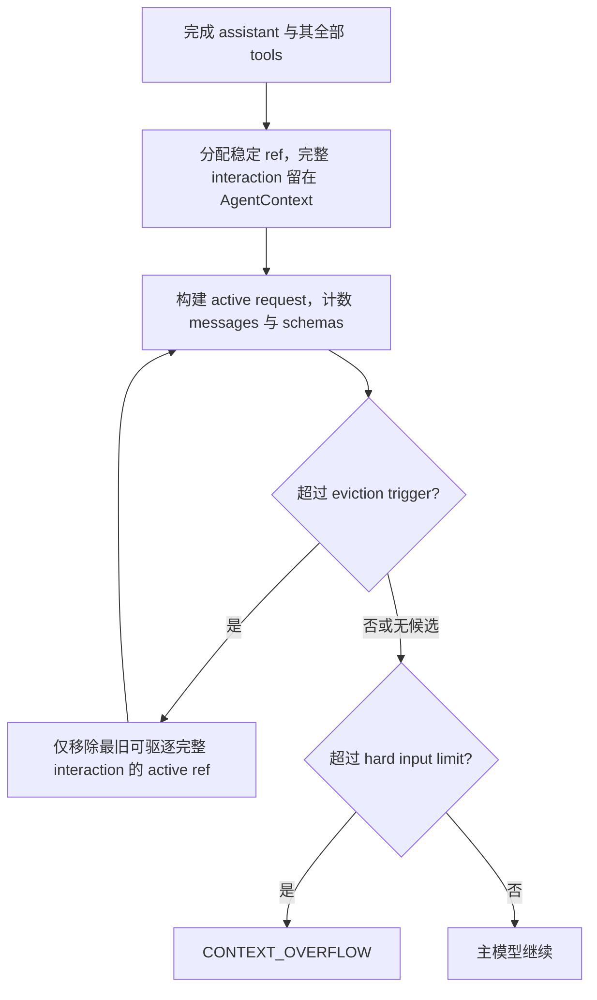

# Context Lifecycle V1：内存工作集与精确读取

日期：2026-10-17。状态：**V1 实施合同；验证结果以技术总览为准**。文件名沿用最初的 v2 设计稿。

2026-10-17 supersession：本文件按用户设计审查结果收敛，取代同日早期草案中的独立 Turn Archive、additive migration、state revision、持久化提交边界与可选 Compactor recovery/retry 方案。上述扩展暂缓，不构成本次实施要求；原先只针对旧实现的离线验证不能证明本次 V1 已验收。当前实现事实与执行结果见 [技术总览](../docs/JOBPILOT_TECHNICAL_OVERVIEW.md)。

## 1. 范围与不变量

保留一个主 Career Agent 与原六个业务工具，增加 turn-local 内部 `checkpoint_task_state` 和 `read_working_context`。本次只实施内存 backing store、稳定 interaction refs、deterministic eviction、简化 Working Task State、tool-schema token accounting 与 provider error classification。

- 不新增 Archive 表、migration、冗余持久化或长期 Memory/Knowledge 数据。
- 当前 `AgentTurn` 的完整 `RuntimeInteraction` 保留在当前 `AgentContext` 内存；pressure 只改变 active membership，不删除原文。
- 当前用户请求完整；native assistant tool calls 与其全部结果整体保留或驱逐，无 orphan tool call/result。
- 不因“模型已看过一次”而移除 evidence，不以 `ui_summary`、source refs 或字符串截断替代原文。
- Observability 仍为 best-effort；不升级成 correctness-critical store，不保证关 capture 或记录缺失后的恢复。
- 不实现进程崩溃后的 AgentTurn resume；重启继续按现有合同把遗留 RUNNING Turn 标为 `ABORTED / PROCESS_RESTART`。
- Eval case、threshold、fixture、Gold、Judge、Retrieval、failure classifier 与 embedding 比较器均保持原合同。

## 2. Interaction identity 与 backing store

每个完整 interaction 分配 turn-local 单调 seq，生成 `ctx://<turn_uuid>/i/<seq>`。seq 不从 active list 下标推导，也不因 eviction、重复 read 或 checkpoint 改变。

完整 `RuntimeInteraction` 包含 runtime 实际收到的 assistant message，以及 assistant 中全部对应的 provider-visible tool messages。无工具的最终 assistant 同样形成完整 interaction。只有完整且配对合法的 interaction 才能加入 backing store 和 context index；pending interaction 不可驱逐或读取。

`AgentContext` 分开维护完整 interactions 与 active refs。active membership 决定下一次主模型输入是否含有该 interaction 的 native messages；移除 membership 不释放或覆盖 backing store 正文。存储数据在本 Turn 结束后不再作为新 Turn 的工作上下文；不建立跨 Turn 自动召回入口。

`ctx://` 是工作上下文引用，不是 `SourceRef`。现有 `message://...`、`document://.../section/...`、`document://.../chunk/...` grounding 合同不变；`ctx://` 不写入 MemorySource 或业务 ToolResult 的 source-ref schema，也不表示模型生成的 state 文本已被证明为真。

## 3. Active request 与 deterministic eviction

主模型 request 包括 System Prompt、CORE Profile、近期 Conversation、完整当前请求、Working Task State、代码生成的 context ref index、active runtime native interactions，以及 Registry schemas。state/index 是派生数据，不得提升为 system instructions。



最终无工具回答在保存完整 interaction 后完成 Turn，不为不存在的下一次 model request 额外做 admission。

预算定义：

| 设置 | V1 合同 |
| --- | --- |
| `hard_input_limit` | `LLM_CONTEXT_WINDOW - LLM_MAX_OUTPUT_TOKENS - CONTEXT_SAFETY_MARGIN_TOKENS` |
| `CONTEXT_EVICTION_TRIGGER_TOKENS` | 可选正整数且不超过 hard limit；未设置时保持 `min(48_000, int(hard_input_limit * 0.70))` |
| `context_eviction_trigger` | Settings 中解析后的有效 trigger property |
| `soft_input_limit` | 兼容 alias；不再表示调用 Compactor |
| `RECENT_RAW_RUNTIME_KEEP_COUNT` | 默认 1，最小 1；与 Conversation target/max 独立 |
| `WORKING_TASK_STATE_MAX_TOKENS` | 默认 6000；限制完整 serialized Working Task State |
| `CONTEXT_COMPACTION_MAX_TOKENS` | 保留 legacy 配置，当前 pressure 路径不使用 |

低于 trigger 不因 keep count 主动丢弃旧 active 内容。超 trigger 按 oldest-first 逐个移除完整 interaction 的 active ref，每次重建完整 request 并重新计数；不调用 LLM、不要求先生成 summary 或 checkpoint。当前请求、CORE、state/index 与最新 keep-count 组不属于可驱逐 candidates。

如果没有候选，允许在 trigger 以上、hard limit 以下继续。超过 hard limit 则 fail closed 为 `CONTEXT_OVERFLOW`，不偷偷缩短当前请求、最新 evidence 或其他不可驱逐部分。

Token guard 包括真正发送的 tool schemas，而非只数 messages。messages、schemas 的本地估算与 provider usage 分别保留，不能把估算宣称为精确账单；恢复结果的 wrapper、JSON 转义和同组其他结果均应以实际 serialized request 重新计数。

## 4. 精确 read 与 observability fallback

内部工具形状：

```json
{"refs": ["ctx://<current-turn>/i/17"]}
```

工具只接受当前 Turn 的合法完整 interaction refs，不接受 query、embedding、BM25、任意路径或外部 turn id。ref 的语法、当前 turn 归属、存在性和完整 pairing 均由代码检查；非法 ref 用 `VALIDATION_ERROR` / `NOT_FOUND` 拒绝，不部分返回或猜测正文。

读取顺序固定：

1. 优先从当前 `AgentContext` 的完整 interaction backing store 精确读取，active 中不存在不代表内存缺失。
2. 仅当内存中缺失时，best-effort 尝试使用已有 observability MODEL/TOOL records 重建；必须确认当前 turn、合法 sequence、完整 assistant/tool pairing 与完整 provider-visible payload。
3. capture 关闭、记录缺失、配对不完整或无法精确重建时，返回 `ToolResult(ok=false, error.code="DOMAIN_ERROR")`，`agent_payload.reason="WORKING_CONTEXT_NOT_RECOVERABLE"`。不伪造空成功、source-only 结果、摘要或部分 interaction。

成功结果按 refs 返回完整 provider-visible interaction 数据，作为本次 `read_working_context` ToolResult 的内容；不把旧 assistant/tool messages 再注入为 native execution，不重放原工具，不制造重复 call IDs。现有 source refs 保持其原始来源含义，debug-only observation 不升级为模型 evidence。

read 返回正文前检查整组 admission：assistant message、该轮所有 ToolResults、最终 Working Task State、context index、原有 active history 和 schemas 一起计数；允许对更老的可驱逐 active interactions 做确定性 eviction。恢复正文作为最新 interaction 的工具结果，至少供下一次主模型实际消费。无法完整容纳时，返回 `DOMAIN_ERROR` 且 `agent_payload.reason="WORKING_CONTEXT_CAPACITY_EXCEEDED"`，不静默截断或部分成功。错误结果也要纳入最终请求计数，仍放不下则按普通 hard limit 失败。

exact read 绕过普通相同参数缓存/duplicate guard，每次按当前内存、scope 和容量重新检查；原六个业务工具的 fingerprint/cache 规则不变。内部工具本身形成新的完整 interaction，遵守同一 pairing、ref 和 retention 规则。

此 fallback 是当前进程执行中的恢复辅助手段，不是 durable Archive 或 AgentTurn resume 协议；trace 写入失败继续沿用既有 best-effort 语义。

异常缺失边界：如果已知 active ref 的 raw 内存已经缺失且 fallback 失败，`mark_not_recoverable` 只移除该缺失项的 active membership，known ref/index 继续保留并标 `recoverable=false`，使明确的不可恢复工具结果仍可被主模型消费。它不删除仍存在的原文，不属于正常 pressure eviction，也不把 summary 当作修复。

## 5. 简化 Working Task State

`checkpoint_task_state` 只接收 add-only delta：

```text
established_facts_add: [{text, refs: []}]
decisions_add: [{text, refs: []}]
open_questions_add: [{text, refs: []}]
completed_actions_add: [{text, refs: []}]
```

当前完整用户请求提供任务目标，不新增 objective 修改接口。state 由代码合并，仅存在当前 `AgentContext` 内。重复条目可确定性去重；refs 必须来自当前已完成的 ctx interaction 或现有作用域内的合法 SourceRef。合法 ctx ref 只能证明某 interaction 存在，不能证明模型写入事实的语义为真。

合并前在候选状态上计数，超过 `WORKING_TASK_STATE_MAX_TOKENS` 则明确拒绝并保留旧 state，不截断 entry。State 不能替代原文或允许删除 backing store；不写长期 Memory、Knowledge 或新表。

V1 不实现 revision、remove/replace、持久化 state、自动 conflict detection、phase detector、Compactor consolidation/recovery 或对应 transport retry。主 Agent 只在获得关键事实、作出决定、完成阶段或发现未决问题时提交小 delta，不要求每个轮次都 checkpoint。

## 6. Provider 错误与旧逻辑

普通 context pressure 不产生 provider call。`ContextCompactor` 和旧 `CONTEXT_COMPACTION` trace schema 保留为 legacy，runtime 不调用它们；本次不引入 `NONFATAL_ERROR` 状态，不调整 Eval failure classifier 或 provider interruption 判分。

主模型异常继续用已有 provider classification。顶层 generic exception 保留可识别的 provider error code，未知代码错误才归为 `INTERNAL_ERROR`；不能把 provider interruption 全部覆盖成内部故障。取消、总 deadline、policy budget 与 restart 边界保持原合同。

## 7. 验证与真实验收边界

离线回归应覆盖：完整内存 backing store 与 ref 稳定性、native pairing、低压保留、oldest-first eviction/keep count、压力路径 Compactor 零调用、schema token accounting、当前请求和 hard failure、checkpoint add-only 与超限回滚、ref/scope 校验、read 内存优先、capture 缺失或不完整时明确不可恢复、read admission/同组其他结果、重复 read 不走 cache、provider classification。

本次无 migration，不应修改历史 revision 或声称已升级数据库。真实 A1/Suite 前须核查 canonical Eval DB readiness、隔离 fixture/corpus/identity 与模型出站条件；离线测试或 preflight 通过不证明真实任务质量、token/latency 改善。2026-10-17 已实际尝试 canonical Eval DB 只读 readiness smoke，受控重试结果为 `connection_refused`，本轮 readiness 不可用；未执行真实 Suite、provider 调用、migration 或新建表。

Context lifecycle 实验固定现有 cases/Gold/fixtures、阈值、主模型/Judge、corpus 与 embedding profile，单列 implementation/lifecycle 设置和实际 trace。现有 embedding A/B 比较器要求不同 profile，与本实验变量不同，保持其规则不变；使用逐 case artifacts 的独立实验记录，不重解释历史结果或冻结新 baseline。

本次已执行：完整 unit suite **675 passed in 11.33s**；Eval preflight **PASS，27 cases / 280 checks，provider_calls=0**。真实 A1/Suite 与 PostgreSQL integration 因上述数据库 readiness 限制未运行，未调用真实 provider。详细记录见 Context Lifecycle V1 迭代记录（历史资料未包含在公开快照中） 与 [技术总览 Testing](../docs/JOBPILOT_TECHNICAL_OVERVIEW.md#15-testing)。
