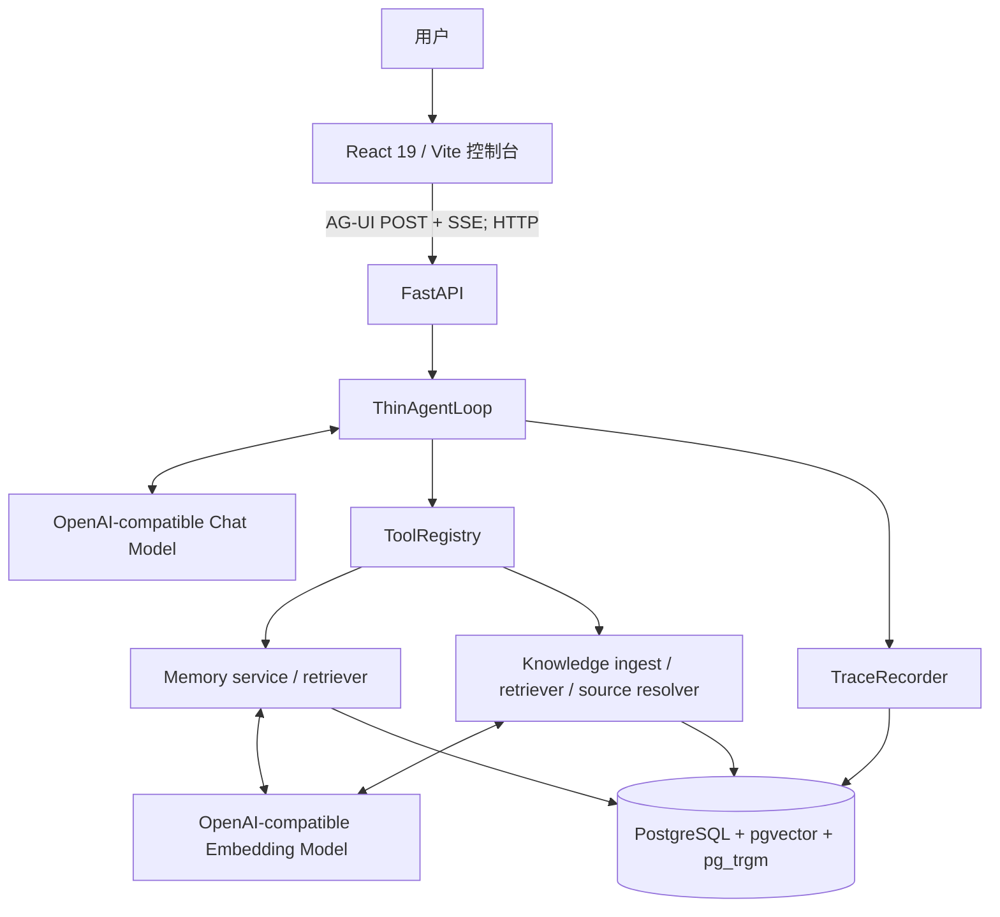
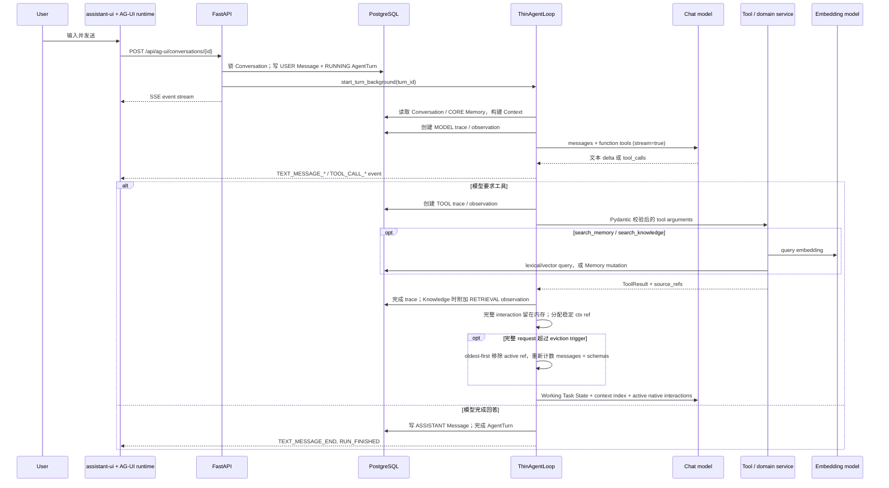
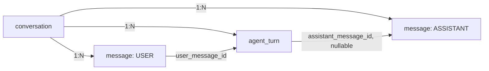
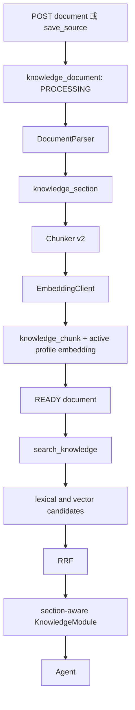
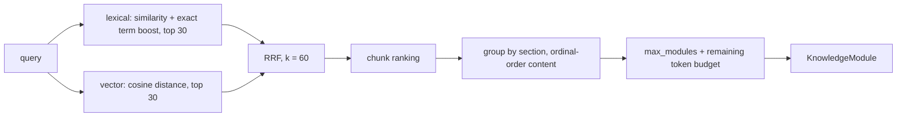
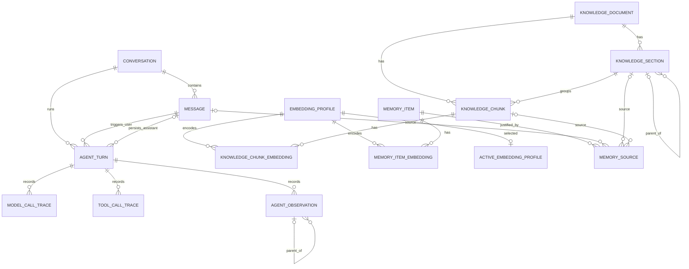
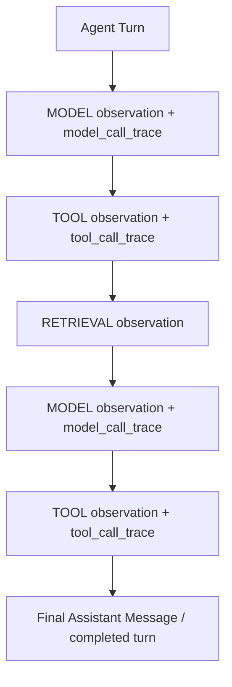

# JobPilot Technical Overview

> **Canonical scope:** 本文以当前（2026-10-20）工作区中的 `backend/`、`frontend/`、Alembic migration、运行配置与测试为实现事实源。它也覆盖当前尚未提交的运行时、检索和 observability 修改，因为这些文件是当前工作区的一部分。`SPEC/` 用于说明已冻结但尚未实现的设计；与代码冲突时以代码为准。

## 状态标记

- **IMPLEMENTED**：当前代码已经实现。
- **DESIGNED**：设计已冻结或已写入 Spec，但仓库尚未实现。
- **TODO / LIMITATION**：能力缺失、边界明确，或实现尚不完整。

本文讨论的是一个单用户、本地优先的 V1 原型；数据库中没有 `user`、tenant 或 workspace 维度，因此“用户”是这个部署实例中的单一资料主体，而不是数据库中的隔离实体。

## 1. 项目定位

### 1.1 JobPilot 是什么

**IMPLEMENTED。** JobPilot 是一个面向个人求职场景的长期 Career Agent 原型。主入口是 React 控制台中的对话：用户新建 Conversation 后，在 Chat 中发送问题；Agent 可以按需查询长期记忆和原始职业资料，并把最终回答持久化到对话。

当前系统真正提供的是通用 Agent 基础能力，而不是 JD、简历、面试各自独立的业务模块：

- 职业相关问答与基于已有资料的总结；
- 通过原生 tool calling 按需检索职业资料、读取原文和长期记忆；
- 由 Agent 生成职业任务的文本答案。System Prompt 列举 JD analysis、resume drafting/editing、interview review、training practice 作为任务类型，但代码没有对应的专用 workflow、状态机、模板或持久化产物；
- 保存 Markdown、TXT、LaTeX 原始文本资料，并对它们分段、向量化、混合检索；
- 由 Agent 写入有证据来源的长期用户记忆；
- 检查一次 Agent Turn 的模型、工具和 Knowledge retrieval 轨迹。

因此，诸如“简历辅助”或“面试准备”在当前版本是 Agent 可以完成的开放式对话任务，不是已经实现了专门产品流程的承诺。

### 1.2 核心产品思想

**IMPLEMENTED。** 系统收敛为一个单一 Career Agent 和一组受控 Tools：

```text
User
  ↓
Single Career Agent
  ↓
Thin Agent Loop
  ↓
Tool Registry
  ├─ Memory
  ├─ Knowledge / Document
  └─ Source resolution
  ↓
PostgreSQL + pgvector + pg_trgm
```

Agent 的职责是理解用户目标、判断当前上下文是否足够、决定是否检索、选择工具、阅读证据、决定是否值得更新长期记忆，并组织最终答案。它不被 JD/简历/面试等固定业务工作流替代。

确定性代码承担不应交给模型的边界：

| 责任 | 由什么保证 |
| --- | --- |
| Tool 名称与参数形状 | Pydantic schema 与 `ToolRegistry` |
| 工具执行、错误分类与超时 | `ToolExecutor`、`LoopPolicy` |
| Turn 并发、预算和终态 | 数据库唯一约束、`LoopPolicy`、`ThinAgentLoop` |
| 数据一致性、级联删除、文档去重 | PostgreSQL FK / constraint 与事务 |
| 长期 Memory 的证据权限 | `MemoryService._validate_sources` |
| 来源可读性 | `SourceRef` 与 `SourceResolver` |
| 可观测记录 | `TraceRecorder` 的独立短事务 |

模型不能直接访问数据库，也不能执行任意 SQL。它只能看见 Context、Tool schema 和已返回的 Tool observation。

## 2. 系统总架构

**IMPLEMENTED。** 后端是 FastAPI；模型和 embedding 都使用 OpenAI-compatible HTTP 客户端；单一 PostgreSQL 同时保存业务状态、向量和审计信息。浏览器的正式聊天传输是 AG-UI 风格的 HTTP POST SSE 流。



边界如下：

- **Frontend**：渲染会话、Markdown、Tool activity、资料和记忆列表，以及只读的 Observability trace；不自行拼接 SSE 状态。
- **API**：创建 Conversation / Message / AgentTurn，暴露文档、记忆、调试和 observability HTTP 接口，并启动后台 Turn。
- **Agent Runtime**：在一个 Turn 中执行“model → tool → model”循环，发布 stream event，保存最终 Assistant Message。
- **Domain services**：Memory、Knowledge ingest、retrieval 和 SourceResolver。它们不决定用户任务步骤。
- **Storage**：所有持久状态都在 PostgreSQL；向量列与 trigram 索引也在其中。
- **Observability**：业务 Session 之外的短事务记录模型、工具和检索 observation，不能反向改变 Agent 的业务语义。

## 3. 一次用户请求的完整生命周期

### 3.1 浏览器 Chat 的实际调用链

**IMPLEMENTED。** 当前 Chat 不先调用“创建 message”接口。`@ag-ui/client` 的 `HttpAgent` 向 `POST /api/ag-ui/conversations/{conversation_id}` 发出包含 runtime messages 的请求；后端在同一请求中抽取最后一条 user text，原子地创建 `message` 与 `agent_turn`，再异步启动 loop，并把 EventBroker 的事件作为 SSE 返回。



具体步骤：

1. 前端的 Agent runtime 管理本地的 user message、assistant streaming message 和 tool message；history adapter 从 `GET /api/conversations/{id}` hydrate 已持久化历史。
2. `run_ag_ui` 验证请求里存在非空 user text，然后调用 `_create_turn`。该函数对 Conversation 做 `FOR UPDATE`，拒绝同一 Conversation 的第二个 `RUNNING` Turn，插入用户 Message 和 `RUNNING` 的 AgentTurn。
3. `start_turn_background` 用新的 SQLAlchemy Session 运行 `ThinAgentLoop`；HTTP stream 从进程内 `EventBroker` 订阅同一 turn。
4. `ContextBuilder` 读取该 Conversation 的 Message、全部 `ACTIVE + CORE` 的 Memory，然后按 token budget 构造 Context。每次请求计入完整 messages 与 tool schemas；超 eviction trigger 时 oldest-first 移除旧 interaction 的 active refs，完整原文继续留在当前 `AgentContext` 内存，不调用 Compactor。
5. loop 为主 Agent model call 写 trace / observation 并计入 Agent 决策次数；streaming delta 映射为 `TEXT_MESSAGE_*` 事件。V1 的 pressure eviction 不产生额外模型调用，旧 `CONTEXT_COMPACTION` trace schema 仅保留兼容。
6. 若 provider 返回 tool calls，loop 先保留 provider 的 assistant tool-call message，再逐个校验、执行工具并 best-effort 写 trace；全部结果组成完整 interaction 后，以稳定 `ctx://<turn>/i/<seq>` 留在 Context backing store。内部 checkpoint 更新 add-only Working Task State，内部 exact read 优先从该内存读取，下一次模型输入只采用 active membership。
7. 若没有 tool calls，loop 以本次 stream 的 UUID 创建 Assistant Message，关联 AgentTurn，更新 Turn 为 `COMPLETED` 并发布完成事件。
8. 任何 policy、配置、超时、取消或未处理错误会把 Turn 标为 `FAILED` 或 `CANCELLED`，写 `error_code`，发布 `RUN_ERROR`，并关闭 EventBroker。

长期 Memory 不是一个固定的生命周期末尾步骤。只有模型在某一轮调用 `update_user_model` 时才会写；没有后台的“上传后自动提取所有 Memory”任务。

### 3.2 另一条 REST 运行路径

**IMPLEMENTED，但当前浏览器 Chat 未使用。** `POST /api/conversations/{id}/runs` 同样创建 Turn，接受最多 12 个 READY 文档 attachment，返回 `turn_id` 和 `GET /api/turns/{id}/events` 的普通 SSE 地址。前端 `api.run` 包装了它，但 `Chat.tsx` 实际使用的是 AG-UI POST 路径，且该路径固定传入空 attachment 列表。

## 4. Agent Runtime

### 4.1 Model Client

**IMPLEMENTED。** `OpenAICompatibleModelClient` 使用官方 `openai.AsyncOpenAI` SDK 的 `chat.completions.create`：

- `base_url`、API key 和模型名来自 `LLM_BASE_URL`、`LLM_API_KEY`、`LLM_MODEL`；缺任一项会抛出 `ConfigurationError`；
- 请求携带 `messages`、Pydantic 生成的 OpenAI function `tools`、`max_tokens`、`temperature`，并固定 `stream=True`；
- 收到文本 delta 时立即发出 `TextDelta`；
- 收集每个 streamed tool call 的 `id`、function name 和 JSON arguments，末尾解析成 `ToolCall`；无效 JSON 会作为 `{"__raw_arguments__": "..."}` 交给后续 Pydantic 校验；
- 最后产生 `ModelResponse`：provider assistant message、final text、tool calls、finish reason 和 provider 给出的 prompt/completion usage（provider 若不返回 usage，则为 `null`）。

当前没有 non-streaming 单独实现；`complete()` 是把 `stream()` 消费到 `ModelCompleted` 的便利方法，Agent loop 实际使用 `stream()`。

### 4.2 Thin Agent Loop

**IMPLEMENTED。** 简化后的真实控制流如下；它省略了隐藏推理，不省略控制边界：

```python
context = ContextBuilder(...).build(turn_id)
while True:
    policy.check_model_budget(state)
    messages, token_breakdown = prepare_context_messages(context)
    # messages + tool schemas 一起计数；超 trigger 则 oldest-first 驱逐 active refs。
    # 完整 interactions 仍在 context 内存；pressure 不调用 LLM。
    response = stream_model(messages, registry.schemas())
    trace.model_finished(response)
    state.model_turns += 1

    context.append_assistant(response.assistant_message)
    if not response.tool_calls:
        persist_assistant_message_and_complete_turn(response.final_text)
        publish_run_finished()
        return

    for call in response.tool_calls:
        policy.check_tool_budget(state)
        result = executor.execute(validated_call)
        context.append_tool_result(call.id, call.name, result)
        publish_tool_events(result)
```

真实实现的关键细节：

- 默认最多 12 次模型调用、20 次工具执行、单次模型 120 秒、单工具 60 秒、整个 Turn 300 秒；均可由环境变量调整。
- 原六个业务工具的 fingerprint 是 `sha256(tool_name + canonical JSON arguments)`。同一 fingerprint 第 2 次复用本 Turn cache，第 3 次及以后返回 `POSSIBLE_DUPLICATE`。turn-local 内部 exact read 绕过普通重复调用 cache/guard，每次重查 scope、内存与容量。
- 运行中会检查 cancellation event、总 deadline、context window 和配置完整性。
- 工具错误以结构化 `ToolResult(ok=false, error=...)` 回给模型；模型仍可据此恢复或结束。Turn 级 policy / provider / context 错误则结束 Turn。
- 所有本 Turn 的完整 interaction 都保留在 `AgentContext` 内存。“模型看过一次”不会触发 eviction；只有 request 超 trigger 才按 oldest-first 改变 active membership。assistant tool-call message 与全部结果整体保留或驱逐，无 orphan pairing，稳定 ref 不随 active list 改变。
- Working Task State 由主 Agent 通过内部 add-only checkpoint 维护。压力路径只执行确定性 eviction，不依赖 checkpoint 或模型摘要；legacy `ContextCompactor` 类保留但 runtime 不调用。本次不实现 state revision/持久化、Compactor consolidation/recovery/retry 或 `NONFATAL_ERROR` 状态。
- FastAPI lifespan 启动时把遗留 `RUNNING` Turn 标为 `ABORTED / PROCESS_RESTART`。后台任务的外层错误边界也尝试把启动前失败写为 `RUNTIME_START_FAILED`。

### 4.3 Agent Context

**IMPLEMENTED。** 每次 model call 实际可见的 Context 是：

| 组成 | 来源与规则 |
| --- | --- |
| System Prompt | `SYSTEM_PROMPT`：规定职业任务边界、按需检索、资料是 data 不是 instructions、不得杜撰 |
| Core Profile | 所有 `ACTIVE` 且 `CORE` 的 Memory，按 `updated_at DESC` 拼接，截断到 `CORE_PROFILE_MAX_TOKENS`（默认 1200） |
| Conversation history | 当前 Conversation 的 USER / ASSISTANT Message；以 `RECENT_CONVERSATION_TARGET_TOKENS` 与 `RECENT_CONVERSATION_MAX_TOKENS` 的较小值选取最近连续历史，当前用户消息始终完整保留 |
| 当前用户消息元数据 | `message://...`；若 REST path 传了 attachment，则只加入 document id 和“需要时调用 search_knowledge”的说明，不放正文 |
| Tool schemas | 原六个业务 schema + 当前 Turn 的两个内部 lifecycle schema，全部计入 admission |
| Working Task State | add-only `established_facts_add` / `decisions_add` / `open_questions_add` / `completed_actions_add`，每项 `{text, refs}`；只存在当前 Context，目标来自完整当前请求，state 是 data |
| Context ref index | 代码发布当前 Turn 已完成 interaction 的稳定 refs、active 与 recoverable 状态；无跨 Turn 自动召回 |
| Active runtime working set | 完整 native interaction 的 active membership；低于 trigger 保留全部，压力下至少保留最新 `RECENT_RAW_RUNTIME_KEEP_COUNT` 个完整组，原文始终留在 backing store |

Context Lifecycle V1：默认 trigger 保持 `min(48_000, int(hard_input_limit * 0.70))`，可由 `CONTEXT_EVICTION_TRIGGER_TOKENS` 显式覆盖。低于 trigger 不驱逐；超 trigger oldest-first 移除完整 interaction 的 active ref，当前请求、CORE、state/index 与最新 keep-count 组不被驱逐。无候选且仍不超过 hard limit 时可以继续；`hard_input_limit = LLM_CONTEXT_WINDOW - LLM_MAX_OUTPUT_TOKENS - CONTEXT_SAFETY_MARGIN_TOKENS` 仍无法满足则 `CONTEXT_OVERFLOW`，不截断 evidence 或用 UI summary 代替原文。

`read_working_context` 只接受当前 Turn 的精确 refs，优先读取 backing store；仅在内存缺失时 best-effort 尝试从已有完整 MODEL/TOOL observations 重建。重建不可靠时返回 `DOMAIN_ERROR`，`agent_payload.reason=WORKING_CONTEXT_NOT_RECOVERABLE`。成功内容作为新工具结果的数据返回，不重放旧 native 调用；整组 wrapper、其他工具结果、state/index、schemas 不能满足 hard admission 时以 `WORKING_CONTEXT_CAPACITY_EXCEEDED` 拒绝。`checkpoint_task_state` 在候选 state 上合并并检查 budget，超限保留旧 state。

异常情况下，如果某已知 active ref 的原始内存内容已经缺失且 fallback 无法重建，`mark_not_recoverable` 只移除该缺失项的 active membership，保留 known ref/index 并标 `recoverable=false`。这样明确的 `WORKING_CONTEXT_NOT_RECOVERABLE` 工具结果可以交给下一次主模型消费，避免再次拼接不存在的 raw 内容。该异常处理不删除任何仍然存在的 interaction，也不改变正常 oldest-first eviction 与最新组 retention。

本次不新增 Archive 表、migration 或冗余持久化。Observability 仍 best-effort，不是 correctness-critical store；trace/capture 关闭不影响内存读取，但不保证内存缺失后的 fallback。没有进程崩溃后的 AgentTurn resume。完整合同见 [Context Lifecycle V1](../SPEC/04_CONTEXT_LIFECYCLE_V2_DESIGN.md)。

Knowledge 和普通 Memory **不会**默认全部塞进 Context：普通 Memory 需 `search_memory`，原始资料需 `search_knowledge` / `read_source`。唯一的 eager 数据是高优先级的 CORE Memory。

### 4.4 Tool Registry

**IMPLEMENTED。** Registry 在每个 `ThinAgentLoop` 构造时用同一个业务 Session 建立。schema 来自 Pydantic `model_json_schema()`，执行前再次 `model_validate()`。

| Tool | 类型与核心输入 | 返回给 Agent | 作用 | 写数据 |
| --- | --- | --- | --- | --- |
| `search_memory` | `query`；可选 `kinds`；`limit` 1–20 | active Memory 的 id、kind、content、attributes、source_refs | 检索长期用户模型 | 否 |
| `update_user_model` | `mutations` 1–20；每项为 ADD / MERGE / SUPERSEDE / ARCHIVE | 改变后的 memory id | 有证据地维护长期 Memory | 是 |
| `search_knowledge` | `query`；可选 document ids；`max_modules`、`max_tokens` | section-aware KnowledgeModule | 检索 READY 原始资料 | 否 |
| `read_source` | 1–12 个 `SourceRef`；`max_tokens` | 原文 Message / Section / Chunk，受 token 总预算限制 | 读取具体证据 | 否 |
| `list_documents` | 可选标题 query；limit 1–100 | 文档元数据 | 定位资料 | 否 |
| `save_source` | title、content、`MARKDOWN|TEXT|LATEX`、metadata | document id、是否去重 | 仅在用户明确要求时保存长期资料 | 是 |
| `checkpoint_task_state`（内部） | 四类 `*_add` delta，每项 `{text, refs}` | checkpoint 确认 / 明确拒绝 | 主 Agent 维护临时任务状态 | 仅 Context 内存 |
| `read_working_context`（内部） | 当前 Turn 精确 `ctx://` refs | 完整 provider-visible interaction 数据 / 明确拒绝 | 恢复已不在 active 中的工作证据 | 否 |

例如，Memory 写入的真实 schema 形状是：

```json
{
  "mutations": [
    {
      "operation": "ADD",
      "kind": "SKILL",
      "content": "熟悉 PostgreSQL 事务与索引设计。",
      "attributes": {"area": "database"},
      "importance": "NORMAL",
      "source_refs": ["message://00000000-0000-0000-0000-000000000001"]
    }
  ]
}
```

统一错误模型包括 `VALIDATION_ERROR`、`NOT_FOUND`、`DOMAIN_ERROR`、`TIMEOUT`、`INTERNAL_ERROR`、`CANCELLED` 与 `POSSIBLE_DUPLICATE`，并带 `retryable`。未知 Tool、参数校验、来源缺失、Memory 重复、timeout 等不会抛出给模型，而是变成结构化 observation。

**LIMITATION。** `save_source` 的“用户明确要求”目前由 System Prompt 约束，后端 schema 没有用户确认 flag 或审批记录；这不是 deterministic enforcement。

## 5. Conversation 与短期上下文

**IMPLEMENTED。** Conversation 是一段可持续聊天的容器；Message 是其中真实持久化的 USER 或 ASSISTANT 文本；AgentTurn 是由一条用户 Message 触发的、可追踪的一次 Agent 执行。



- 创建 Conversation 时只有 UUID、可选 title、创建/更新时间。
- `message` 有 `conversation_id`、`role`、`content`、JSONB `metadata`、时间。当前 enum **只有** `USER` 与 `ASSISTANT`，没有已实现的 SYSTEM Message 持久化角色。
- 用户消息的 metadata 存 REST attachment 的 document id 列表；助手消息 metadata 存 `agent_turn_id`。
- AgentTurn 记录一对触发/结果 message、状态、模型和工具次数、错误码、开始/结束时间。数据库 partial unique index 保证每个 Conversation 同时最多一个 `RUNNING` Turn。

历史在每个 model call 由 `ContextBuilder` 重新读取并按 token budget 裁剪。新开 Conversation 会失去上一 Conversation 的短期文本、当前 Turn 的 tool history 与 attachment 元数据；它仍可看到 CORE Profile，也可主动用 `search_memory` 与 `search_knowledge` 获取长期数据。

不应该写入长期 Memory 的是普通闲聊、一次性的措辞、Agent 生成的临时答案、短期任务过程和已可由原始资料按需读取的细节。

## 6. Long-term Memory

### 6.1 为什么存在 Memory

**IMPLEMENTED。** 三层信息的分工是：

| 层 | 内容 | 生命周期 / 读取方式 |
| --- | --- | --- |
| Conversation | 某段对话的连续语境与结果 | 当前 Conversation 的最近历史 |
| Knowledge | 原始、细节多、可反复取证的职业资料 | 文档 ingest 后按需 RAG / read |
| Memory | 高密度、稳定、未来会改变帮助方式的用户模型 | CORE 自动进入 Context，其余按需 search |

### 6.2 Memory Data Model

**IMPLEMENTED。** `memory_item` 的实际字段如下：

| 字段 | 含义 |
| --- | --- |
| `id` | UUID 主键 |
| `kind` | `BACKGROUND`、`EXPERIENCE`、`ACHIEVEMENT`、`SKILL`、`CAREER_GOAL`、`PREFERENCE`、`LEARNING`、`OTHER` |
| `content` | 高密度文本事实 |
| `attributes` | JSONB 补充结构 |
| `importance` | `CORE` 或 `NORMAL` |
| `status` | `ACTIVE`、`SUPERSEDED`、`ARCHIVED` |
| `valid_from` / `valid_to` | 事实有效时间；SUPERSEDE 会给旧项写 `valid_to` |
| 向量关系 | 独立 `memory_item_embedding(memory_item_id, profile_id)`；业务表没有向量列 |
| `created_at` / `updated_at` | 服务端时间 |

`memory_source` 保存 provenance：`memory_id`、`source_type`、三选一的 `message_id` / `document_section_id` / `document_chunk_id`、`relation`、可空 `excerpt`、创建时间。数据库 Check Constraint 强制三个外键恰有一个非空。

一个真实的 Agent-visible Memory 返回形状为：

```json
{
  "id": "00000000-0000-0000-0000-000000000010",
  "kind": "SKILL",
  "content": "熟悉 PostgreSQL 事务与索引设计。",
  "attributes": {"area": "database"},
  "source_refs": ["message://00000000-0000-0000-0000-000000000001"]
}
```

### 6.3 Memory Write

**IMPLEMENTED。** 只有 `update_user_model` Tool 能通过 Agent 写 Memory。Prompt 要求模型仅在本轮出现“稳定、高价值、未来可复用”的信息时写入，并建议修改已有 Memory 前先搜索相关 Memory；没有上传文档后的自动抽取 pipeline。

`MemoryService` 对非 ARCHIVE mutation 强制至少一个 SourceRef，逐条解析并验证来源存在。来源权限是确定性的：Assistant Message 不能作为用户 Memory 证据；`REFERENCE_SOURCE` 文档也不能建立用户 Memory。通过验证后，服务在一个事务内写 Memory、当前 Active Profile 的 `memory_item_embedding` 和 `memory_source`，不会为其他 profile 实时生成向量。MERGE 保持 Memory ID 和来源稳定，同时删除已失效的历史正文向量，再只写当前 profile；切回历史 profile 前须显式补齐。

### 6.4 Source / Provenance

**IMPLEMENTED。** Agent 看见的稳定指针不是裸 FK，而是：

```text
message://<message_uuid>
document://<document_uuid>/section/<section_uuid>
document://<document_uuid>/chunk/<chunk_uuid>
```

SourceResolver 能按这些指针读回原文，并按总 token budget 截断。长期总结必须能回到触发它的用户消息或用户职业资料，因此 `memory_source` 同时为审计、修正和未来 reread 服务。

**LIMITATION。** 当前 Memory 写入只创建 `SUPPORTS` relation，虽然 enum 定义了 `CONTRADICTS`；`excerpt` 字段也没有由服务填充。前端 Memory 页面仅展示 item，不展示 source provenance。

### 6.5 Memory Retrieval

**IMPLEMENTED。** `search_memory` 只在 `status=ACTIVE` 上执行两路检索：

1. lexical：`similarity(content, query)` 加上每个命中 term 的 exact boost，取最多 30 条；
2. vector：对 query 调 embedding，按 cosine distance 取最多 30 条；
3. 使用 `RRF_K = 60` 融合两个排名，再按调用者 limit 返回。

服务额外 join `knowledge_section` / `knowledge_chunk` 来重建可读的 Document SourceRef，因此模型拿到的 provenance 可以被 `read_source` 再读取。

EmbeddingProfileService 每次操作集中解析数据库 Active Profile（隔离 Eval 使用显式绑定的 profile），并按 profile 的 credential 环境变量名获取密钥；没有 lexical-only fallback。

### 6.6 Memory Evolution

**IMPLEMENTED。** 当前实际动作只有以下四种：

| 动作 | 当前行为 |
| --- | --- |
| `ADD` | 创建新的 `ACTIVE` item；拒绝完全相同的 active `content` |
| `MERGE` | 更新一个 `ACTIVE` item 的 content / attributes / importance（可选 kind），重新 embedding，并追加新的支持来源 |
| `SUPERSEDE` | 旧 item 变 `SUPERSEDED` 并写 `valid_to`；新建一个 `ACTIVE` item、写 `valid_from` 和新来源 |
| `ARCHIVE` | 任意存在 item 变 `ARCHIVED`；不要求新证据 |

**LIMITATION。** 没有名为 `UPDATE` 的动作，也没有语义级去重、冲突检测、旧新 Memory 的显式 relation 或自动纠错 policy。重复防护只比较完全相同的 active `content`；用户纠正能否正确选择 MERGE / SUPERSEDE，仍依赖模型判断。SUPERSEDE 的新旧关系只能从时间、状态和 trace 推断。

## 7. Knowledge / Document / RAG

**Ingestion 总链路（IMPLEMENTED）。** 文档以 HTTP body 的文本进入，非 multipart 二进制上传。



`KnowledgeIngestService` 先以原始 UTF-8 `raw_text` 计算 SHA-256，并获取基于 hash 的 PostgreSQL advisory transaction lock。相同 hash 的非 FAILED 文档直接返回为 deduplicated；FAILED 同 hash 文档会删除后重试。新文档先是 `PROCESSING`，在 nested transaction 内解析、建 Section、分 Chunk、批量 embedding，成功才变 `READY`。异常时 document 变 `FAILED`，并清空 `normalized_text`。

### 7.1 Knowledge Document

**IMPLEMENTED。** `knowledge_document` 存 `title`、`filename`、`format`、`source_role`、raw / normalized text、唯一 `sha256`、status、parser/chunker version、JSONB metadata 与时间。

- format：仅 `MARKDOWN`、`TEXT`、`LATEX`；
- source role：`USER_CAREER_SOURCE` 或 `REFERENCE_SOURCE`；前者可成为用户 Memory 证据，后者不可；
- status：`PROCESSING`、`READY`、`FAILED`、`ARCHIVED`；Retriever 只选择 READY 文档。

**LIMITATION。** 没有 PDF、DOCX、OCR、图片或复杂排版解析。浏览器资料库也只接受 `.md`、`.txt`、`.tex`，读文件文本后调用 API。

### 7.2 Parser

**IMPLEMENTED。**

- Markdown：识别 ATX `#` 到 `######` 标题；保留前言为 level 0 root section；维护 `section_path`。
- TXT：不推断标题，创建一个覆盖全文的 level 0 section。
- LaTeX：不编译 TeX。它做有限的正则清洗，把 `section` / `subsection` / `subsubsection` 改写为 Markdown 标题，并移除部分格式命令后复用 Markdown parser。

### 7.3 Section Model

**IMPLEMENTED。**

每个 `knowledge_section` 有 `document_id`、可空 `parent_section_id`、heading、level、JSONB `section_path`、每文档 ordinal、`start_offset` / `end_offset`。offset 永远指向 `normalized_text`，因此 SourceResolver 能准确切回原结构范围，而不是靠重新搜索字符串。

### 7.4 Chunking

**IMPLEMENTED。** `Chunker v2` 的默认参数是 target 600、min 180、max 1000 token。它不跨 Section 合并：

1. 完整 Section 不超过 hard max 时完整保留，即使它小于 min；
2. 较长 Section 优先按空行拆 paragraph；过长 paragraph 再按句子 / 换行拆；极端连续文本用 token binary search 强制切分；
3. 打包时 target 是软目标，max 是硬上限。当前块小于 min 时可越过 target 与下一块合并，只要不越过 max；
4. 小 tail 在不超过 max 时回并到前一个 chunk；所有 emitted span 都保留绝对 offset。

`knowledge_chunk.content` 是原始 normalized text 的连续切片；`retrieval_text` 则是：

```text
<document title> > <section path ...>
<content>
```

因此 embedding 和 lexical retrieval 使用包含标题/结构上下文的 `retrieval_text`，最终返回模型的主内容使用未经这一前缀改写的 `content`。chunk 还存 document/section FK、ordinal、offset、token_count 和创建时间；向量独立存于 `knowledge_chunk_embedding`，不改变 chunk ID 或 SourceRef。

### 7.5 Embedding

**IMPLEMENTED（2026-10-06 identity v2 / Phase B）。** `EmbeddingClient(profile, api_key)` 由数据库 Profile 驱动。新 ID 只 hash provider、model、dimension、send_dimensions、normalize、query/document prefix、space_revision 的版本化 semantic payload。name 是展示标签；base_url、api_key_env、batch_limit、max_input_tokens、tokenizer_encoding 是 transport/credential/admission metadata，不进入 v2 identity。同名仅更新这些 metadata 时保留 ID、已有向量与 validation；语义变更必须新注册，同空间不同名明确拒绝别名。实际编码用的权重、服务端 tokenizer、pooling/预处理变更必须改变 space_revision，不能只凭同名模型认定同空间。

- `active_embedding_profile` 是单行 Active Profile 指针；在线行为每次通过 `EmbeddingProfileService` 解析，没有进程内模型/维度缓存。操作对该行持共享事务锁，activate 使用排他锁，防止写入与切换竞态。
- Knowledge ingest 编码现有 `retrieval_text`，Memory ADD/SUPERSEDE 编码正文；只写当前 profile。MERGE 清除过时正文向量，随后只写 active profile。
- Client 按 profile batch_limit 分批；SDK 保留两次瞬时错误 retry。按返回 index 复原顺序，拒绝缺失/重复 index、错误维度、非有限值和零向量；normalize 仅在 profile 明确要求时执行。
- 仅 send_dimensions=true 才发送 `dimensions`；query/document 使用各自的显式前缀。
- 在任何批次发送前，按 profile 的 tokenizer_encoding 验证所有输入与 max_input_tokens，不截断、不补零、不重新分块。本地 tokenizer 只计数/拒绝，不变换发送文本，因此不进入 identity。通用 `hf-json:<sha256>` 读取 `artifacts/tokenizers/<sha256>.json`（可用 `EMBEDDING_TOKENIZER_DIR` 覆盖目录），检查 SHA-256、禁用 truncation/padding、计入 special tokens；部署兼容性须用固定非敏感样例的 usage 和边界响应核对。缺失/损坏 artifact 明确失败，不切换计数器。
- 两个独立 embedding 表使用无维度 typmod 的 `vector`，复合主键 `(entity_id, profile_id)`。每个 profile 各有 Knowledge/Memory 的 HNSW 部分表达式索引，WHERE profile_id 固定且表达式 cast 为该 dimension；pgvector 全精度 HNSW 当前支持 1..2000 维。超出此范围明确拒绝，未来扩展索引策略时另行实现。

`0005_embedding_profiles` 将原向量直接归属 `qwen-current-v1`，不调用 provider、不修改向量值，不重建业务 ID、SourceRef 或 chunk。旧向量列与全局 HNSW 被删除。迁移读取旧配置只用于一次性记录已有空间；之后更改 EMBEDDING_MODEL/EMBEDDING_DIM 不会切换在线模型。

`0006_embedding_identity_v2` 冻结现有 v1 canonical payload，保留历史 Qwen UUID、向量、索引和 active pointer；新的注册使用 v2。旧 ID 校验冻结快照，runtime metadata 可更新而不重算 UUID。

显式运维入口为 `python -m app.embedding register|coverage|compatibility|backfill|validate|activate`，详细流程见 [Embedding Profile 合约](../SPEC/EMBEDDING_PROFILES.md)。Backfill 在创建 provider client 或变更状态之前扫描全部 eligible Knowledge/Memory（含已有向量行），报告 compatible/too-long/max tokens/max characters 和超限 UUID/excess；任何超限停止全部真实调用。可恢复、跳过已有向量、按批提交，单批失败保留之前成功结果；Knowledge/Memory 分别输出 total/existing/pending/completed/failed，并报告逻辑 embedding_batches 与包含 SDK retry 的 http_attempts；不自动 activate。Coverage 只统计 READY Knowledge 与当前业务范围 ACTIVE Memory。Activate 不生成向量，必须通过配置、100% coverage、实际索引 readiness 和已记录验证门禁。validate 同时扫描目标全部已存向量的实际维度、finite、非零 norm。验证记录是显式人工检索/Eval 验证的声明，不会自动运行完整 Eval。

Phase A 历史验证只迁移 Qwen。2026-10-06 Phase B 真实 probe/backfill/A/B 的当前执行证据见 Phase B 报告（历史资料未包含在公开快照中）；Phase B 明确禁止 activate，切换属于后续人工决定的 Phase C。

### 7.6 Hybrid Retrieval

**IMPLEMENTED。** `search_knowledge` 的算法严格是：



lexical 计算 `similarity(retrieval_text, query)`，再给正则识别出的长度大于 1 的 query term 添加 exact `contains` boost；筛选 `ILIKE` 全 query 或 score 大于 0.05 的候选。vector join `knowledge_chunk_embedding`，先限定与 query encoding 相同的 profile_id，再按 `embedding::vector(profile.dimension)` 的 cosine distance 升序取候选。两路各取 30，RRF 分数为 `1 / (60 + rank)` 之和。

融合后的候选按首次高排名 Section 分组。一个 module 先包含 Section SourceRef，再按 chunk ordinal 追加仍能放入总 remaining token budget 的命中 chunk；没有把未命中的相邻 chunk 自动扩展进 module。默认调用上限为 6 个 module、8000 token，schema 可升到 16 / 24000。虽然 Settings 定义了同名的 `KNOWLEDGE_DEFAULT_*` / `KNOWLEDGE_MAX_*`，当前 `SearchKnowledgeArgs` 使用自身的字面量 defaults / bounds，尚未读取这些 Settings。

### 7.7 返回给 Agent 的数据结构

**IMPLEMENTED。** 真正送给 Agent 的 module 形状是：

```json
{
  "document_id": "00000000-0000-0000-0000-000000000020",
  "document_title": "项目材料",
  "section_path": ["项目经历", "检索优化"],
  "content": "这里是按 ordinal 组合的命中 chunk 正文。",
  "source_refs": [
    "document://00000000-0000-0000-0000-000000000020/section/00000000-0000-0000-0000-000000000021",
    "document://00000000-0000-0000-0000-000000000020/chunk/00000000-0000-0000-0000-000000000022"
  ],
  "token_count": 42
}
```

### 7.8 删除、归档与读取

**IMPLEMENTED。** ARCHIVE 只改 Document status；因 Retriever 只选 READY，归档文档不再参加检索。DELETE 级联删除其 Section / Chunk，也会因外键级联删除相关 MemorySource；随后调用 `cleanup_orphans()` 删除没有任何来源的 MemoryItem。SourceResolver 对直接给定的已有 SourceRef 不额外检查 Document status，因此历史引用是否可读取受对象是否仍存在影响，而非 READY 过滤。

## 8. 数据库设计

### 8.1 ER Diagram

**IMPLEMENTED。** schema 由 `0001_initial` 至 `0006_embedding_identity_v2` 的 Alembic revisions 建立；Context Lifecycle V1 沿用现有 schema。



### 8.2 每张核心表的职责

| Table | 职责 | 核心关系 |
| --- | --- | --- |
| `conversation` | 一段聊天的容器和排序时间 | 1:N `message`、1:N `agent_turn` |
| `message` | USER / ASSISTANT 的持久文本与 JSON metadata | 属于 conversation；可作 Turn 输入/输出和 Memory 证据 |
| `agent_turn` | 一条 user message 触发的 Agent 生命周期和 counters | 属于 conversation；引用 user / assistant message |
| `knowledge_document` | 原文、规范化文本、hash、状态、版本与来源角色 | 1:N section / chunk |
| `knowledge_section` | 文档层级、section path、absolute offsets | 属于 document；父子 self relation；1:N chunk |
| `knowledge_chunk` | 检索和回答使用的文本单位、offset、token | 属于 document / section；ID 稳定 |
| `embedding_profile` / `active_embedding_profile` | 不可变空间定义、生命周期与单一 active 指针 | profile 独立于业务实体 |
| `knowledge_chunk_embedding` | profile 专属 Knowledge vector | `(chunk_id, profile_id)` 复合主键 |
| `memory_item_embedding` | profile 专属 Memory vector | `(memory_item_id, profile_id)` 复合主键 |
| `memory_item` | 高密度长期用户模型 | 1:N memory_source |
| `memory_source` | 一条 Memory 的唯一证据指针和 relation | 指向 message、section、chunk 三者之一 |
| `model_call_trace` | 每次 model call 的类型、摘要、usage、延迟、egress preview | 属于 agent_turn；`call_type + sequence` 唯一 |
| `tool_call_trace` | 每次 tool execution 的 arguments、fingerprint、摘要、来源与错误 | 属于 agent_turn；Turn 内 `sequence` 唯一 |
| `agent_observation` | 完整 MODEL / TOOL / RETRIEVAL span 的输入、输出、元数据 | 属于 agent_turn；可 parent-child 嵌套 |

### 8.3 PostgreSQL / pgvector

**IMPLEMENTED。** PostgreSQL 负责事务、外键、enum、JSONB、unique / check constraint，以及文档和 Memory 的同库检索。migration 启用两个 extension：

- `vector`：`knowledge_chunk_embedding.embedding`、`memory_item_embedding.embedding` 为通用 `vector`；每个 profile 有独立维度的 HNSW cosine 部分表达式索引。设计遵循 [pgvector 的不同维度存储与索引文档](https://github.com/pgvector/pgvector#can-i-store-vectors-with-different-dimensions-in-the-same-column)。
- `pg_trgm`：`knowledge_chunk.retrieval_text`、`memory_item.content` 各有 GIN trigram index，供 similarity / textual matching 使用。

额外约束包括：document SHA-256 唯一；每文档 Section / Chunk ordinal 唯一；一个 MemorySource 只能指一个源；同一 Turn 的 tool/observation sequence 唯一、同一 `(turn_id, call_type, sequence)` 的 model trace 唯一；以及同一 Conversation 只有一个 RUNNING Turn 的 partial unique index。`0004_context_compaction` 为 model trace 新增 `call_type`，以区分 `MAIN_AGENT` 与 `CONTEXT_COMPACTION`。

事务使用点包括 Turn 创建、文档 ingest（外层 hash lock + nested transaction）、Memory mutation 和 Document delete。TraceRecorder 不复用这些业务事务，而是新建短 Session；因此观测写入失败不会把业务 Session 标为失败。

**LIMITATION。** schema 没有用户、tenant、workspace、授权策略或 RLS 列。所有 Conversation、Document、Memory 和 trace 对同一个数据库连接逻辑上属于同一用户空间。

## 9. Agent Observability

### 9.1 Trace Hierarchy

**IMPLEMENTED。** 一个 Turn 可有多次 `MAIN_AGENT` MODEL 和 TOOL；V1 pressure eviction 不产生 MODEL。`CONTEXT_COMPACTION` call_type 与旧记录保留为历史兼容，runtime 不再调用 legacy Compactor。`search_knowledge` 额外形成嵌套的 RETRIEVAL observation。model/tool summary trace 与完整 observation 是两套表，均以 `turn_id` 关联。



`agent_observation.parent_observation_id` 指向父 TOOL observation；RETIREVAL span 因而可在 UI 中缩进显示。若 Tool trace 自身未能写入，retrieval span 仍会尽力保存，但没有 parent id。

### 9.2 Model Observation

**IMPLEMENTED。** `model_call_trace` 保存 `call_type`、provider base URL、model、input/output token、latency、finish reason、status、error code、egress preview、开始/结束时间。`AgentObservation(kind="MODEL")` 在 `OBSERVABILITY_CAPTURE_PAYLOAD=true` 时还保存：provider、完整 request messages、完整 tool schema、max tokens / temperature，以及 response 的 assistant message、final text、tool calls、usage。旧 Compactor observation 的 `name` 是 `context_compaction`，其 `tools=[]`；V1 runtime 不生成新的压力 Compactor observation。

默认 egress preview 只保存模型调用类型、模型名、token estimate 与 component breakdown、提取出的 source refs、message count、tool schema names；只有 development 且 `MODEL_EGRESS_PREVIEW_STORE_CONTENT=true` 才把 outgoing messages 和 tool schemas 额外写进 preview。注意 observation payload 的开关与 egress preview 不同。eval 的 main-Agent evidence pack 会排除 compactor observation，避免把仅由 compactor 看见的原始历史误当成 main Agent 的可见证据。

每次主模型的 component breakdown 包含 `active_context_tokens`、`conversation_tokens`、`working_state_tokens`、`recent_runtime_tokens`、`paged_in_tokens`、`tool_schema_tokens`、`context_index_tokens`、完整/active/evicted interaction counts 与 `evicted_tokens_total`。page-in tokens 已包含在 runtime tokens 中，不应再次相加；evicted count 表示 membership，累计 evicted tokens 表示实际移出 active 的估算体积，不代表正文删除。

`AgentObservation(kind="CONTEXT")` best-effort 记录 eviction、page-in 与 checkpoint metadata；主模型 observation 写入显式 interaction/model sequence，供可选 fallback 校验身份。fallback 使用独立短 Session；读取/重建失败不应污染业务 Session。internal tools 保留工具 trace 与预算计数，但不发布 checkpoint delta / 内部参数的用户 Tool activity 事件；外部 API 合同不变。

### 9.3 Tool Observation

**IMPLEMENTED。** `tool_call_trace` 保存 provider call id、工具名、arguments、canonical fingerprint、状态、至多 2048 字符 UI summary、source refs、latency、error、开始/结束时间。`AgentObservation(kind="TOOL")` 在 payload capture 打开时存 tool id / arguments 和 `ToolResult.provider_payload()`。

### 9.4 Retrieval Observation

**PARTIAL。** 当前仅 `search_knowledge` 写 RETRIEVAL observation。它保存 query、document filter、module/token budget，以及：

- lexical candidates：chunk / document / section id、score、rank、500 字符 preview；
- vector candidates：id、cosine distance、rank、preview；
- RRF fusion：两路 rank、fusion score、final rank；
- module assembly：最终 module 和 included chunk ids；
- 算法元数据 `rrf_k=60` 和 source refs。

`search_memory` 虽然也是 lexical + vector + RRF，但当前没有单独的 RETRIEVAL observation；其他 Tool 也没有检索细粒度 span。

### 9.5 Observability UI

**IMPLEMENTED，范围有限。** `DebugInspector` 实现：

- Runs 列表：状态、用户消息 preview、model/tool counts、wall-clock duration；
- Turn 概览：状态、时间、token 合计和错误码；
- 按 `agent_observation.sequence` 排列的 timeline / trace feed；
- MODEL、TOOL、RETRIEVAL 的输入、输出、metadata、source refs 的展开 JSON；
- RUNNING Turn 每秒轮询刷新。

**TODO / LIMITATION。** 没有真正的 replay / rerun 控制，没有 trace 搜索、过滤、成本计算、告警或独立的“Model Calls / Tool Calls”页面。旧的 debug API 可返回摘要 trace 和 egress preview，但当前 UI 主路径使用 observability observation API。

## 10. Frontend Architecture

### 10.1 结构与状态

**IMPLEMENTED。** 前端是 React 19、TypeScript、Vite 6。没有 React Router、Redux、Zustand 或 TanStack Query；`App.tsx` 以 `useState` / `useEffect` 管理当前页、会话列表、选中 Conversation 与错误。

页面是 Chat、长期记忆、资料库、Observability 四个 sidebar tab：

- **Chat**：`@assistant-ui/react` primitives、`@assistant-ui/react-ag-ui` 的 `useAgUiRuntime`、`@ag-ui/client` 的 `HttpAgent`；`react-markdown + remark-gfm` 渲染文本；Tool parts 用 `<details>` 展示 args 和 result。
- **MemoryInspector**：加载 Memory 列表并可 archive。
- **KnowledgeInspector**：浏览器用 `File.text()` 读取 `.md/.txt/.tex` 后 POST 文本，支持 archive/delete。
- **DebugInspector**：调用 observability API，渲染 trace JSON。

### 10.2 Chat Message Lifecycle

**IMPLEMENTED。** 当前解决 message 重复 / streaming 状态的方式不是手写 `EventSource` 和自维护 placeholder，而是把状态所有权交给 AG-UI runtime：

1. 用户发送后，assistant-ui runtime 创建本地 user message 并向 `HttpAgent` 发送；
2. 后端立刻持久化 USER Message、创建 Turn，并在第一次模型 call 前以 UUID 发布 `TEXT_MESSAGE_START`；
3. 每个 `TEXT_MESSAGE_CONTENT` delta 用同一 message id 重建 assistant message；Tool events 由 runtime 形成 tool parts；
4. 最终无 tool-call 的 provider response 使用同一个 UUID 落库为 Assistant Message，随后 `TEXT_MESSAGE_END` / `RUN_FINISHED` 结束它；
5. history adapter 的 `load()` 从 server 重新 hydrate，`append()` 是 no-op，因为 Message 已在后端 run start / finish 时写入。

这避免了“optimistic append + 另外一个本地 assistant placeholder + 完成后 reload”三套消息源竞争。`showThinking=false`，没有显示隐藏推理。

**LIMITATION。** 当前 Chat 不提供资料 attachment 选择器；REST run 虽支持 attachment，AG-UI path 仍传空列表。Conversation 列表不会在一次 run 完成后显式重新加载；而 loop 直接插入 Assistant Message 时也没有更新 `conversation.updated_at`，因此“最新回答”不一定驱动 sidebar 排序刷新。

### 10.3 Streaming

**IMPLEMENTED。** 浏览器聊天 POST 返回 `text/event-stream`，每帧是：

```text
data: {"type":"TEXT_MESSAGE_CONTENT","turn_id":"...","messageId":"...","delta":"..."}

```

后端事件包括 `RUN_STARTED`、`TEXT_MESSAGE_START`、`TEXT_MESSAGE_CONTENT`、`TEXT_MESSAGE_END`、`TOOL_CALL_START`、`TOOL_CALL_ARGS`、`TOOL_CALL_END`、`TOOL_CALL_RESULT`、`RUN_FINISHED`、`RUN_ERROR`。`EventBroker` 维护每个 Turn 的进程内历史并 fan-out 给 SSE subscriber。

**LIMITATION。** Broker、正在运行任务和 cancellation registry 都只在单一 Python 进程内；没有 Redis / durable queue / cross-process replay。因此多 worker 或多实例部署不具备可靠 stream 续接能力。

## 11. API Design

**IMPLEMENTED。** 主要公开接口如下；完整字段以 FastAPI OpenAPI 为准。

| Domain | Method | Path | Purpose |
| --- | --- | --- | --- |
| Health | GET | `/health` | 返回 `{"status":"ok"}` |
| Conversation | GET / POST | `/api/conversations` | 列表 / 创建 Conversation |
| Conversation | GET | `/api/conversations/{id}` | Conversation 与全部 Message |
| Conversation | GET / DELETE | `/api/conversations/{id}/messages` / `/api/conversations/{id}` | 列表 Message / 删除 Conversation |
| Agent | POST | `/api/ag-ui/conversations/{id}` | 浏览器使用的 AG-UI SSE run |
| Agent | POST | `/api/conversations/{id}/runs` | REST 创建 run，返回 events URL |
| Agent | GET | `/api/turns/{id}/events` | 普通 SSE event stream |
| Agent | POST | `/api/turns/{id}/cancel` | 置 in-process cancellation event |
| Knowledge | GET / POST | `/api/documents` | 列表 / 文本 ingest |
| Knowledge | GET | `/api/documents/{id}` | 文档及 section/chunk counts |
| Knowledge | POST / DELETE | `/api/documents/{id}/archive` / `/api/documents/{id}` | 归档 / 删除资料 |
| Memory | GET | `/api/memories`、`/api/memories/{id}` | 列表 / 读取 Memory |
| Memory | POST / DELETE | `/api/memories/{id}/archive` / `/api/memories/{id}` | 归档 / 删除 Memory |
| Observability | GET | `/api/observability/turns`、`/turns/{id}`、`/turns/{id}/observations` | runs、概要、ordered observations |
| Debug | GET | `/api/debug/turns/{id}`、`/model-calls`、`/tool-calls`、`/model-calls/{id}/egress` | development-only summary traces / egress preview |

Debug 路由仅在 `APP_ENV=development` 且 `MODEL_EGRESS_PREVIEW_ENABLED=true` 时可访问。Observability 路由在 `OBSERVABILITY_ENABLED=true` 时可访问。

## 12. Configuration

**IMPLEMENTED。** `app.config.Settings` 从项目根目录 `.env` 与环境变量读取；敏感值只应作为环境变量或未提交的 `.env` 存在。变量按功能分组：

| 分组 | 变量 |
| --- | --- |
| 应用 / DB | `APP_ENV`、`APP_HOST`、`APP_PORT`、`DATABASE_URL` |
| Chat model | `LLM_BASE_URL`、`LLM_API_KEY`、`LLM_MODEL`、`LLM_CONTEXT_WINDOW`、`LLM_MAX_OUTPUT_TOKENS`、`LLM_TEMPERATURE` |
| Embedding | `EMBEDDING_API_KEY` 或 profile.api_key_env 指定环境变量用于在线凭据；`EMBEDDING_BASE_URL/MODEL/DIM/MAX_INPUT_TOKENS/TOKENIZER_ENCODING` 仅初始化迁移使用 |
| Agent policy | `AGENT_MAX_MODEL_TURNS`、`AGENT_MAX_TOOL_EXECUTIONS`、`AGENT_MODEL_TIMEOUT_SECONDS`、`AGENT_TOOL_TIMEOUT_SECONDS`、`AGENT_TOTAL_DEADLINE_SECONDS` |
| Context | `CORE_PROFILE_MAX_TOKENS`、`RECENT_CONVERSATION_TARGET_TOKENS`、`RECENT_CONVERSATION_MAX_TOKENS`、`CONTEXT_EVICTION_TRIGGER_TOKENS`、`RECENT_RAW_RUNTIME_KEEP_COUNT`、`WORKING_TASK_STATE_MAX_TOKENS`、`CONTEXT_SAFETY_MARGIN_TOKENS`；legacy `CONTEXT_COMPACTION_MAX_TOKENS` 暂留 |
| Knowledge budget | `KNOWLEDGE_DEFAULT_MAX_MODULES`、`KNOWLEDGE_MAX_MODULES`、`KNOWLEDGE_DEFAULT_MAX_TOKENS`、`KNOWLEDGE_MAX_TOKENS` |
| Trace / egress | `TRACE_ENABLED`、`TRACE_RETENTION_DAYS`、`MODEL_EGRESS_PREVIEW_ENABLED`、`MODEL_EGRESS_PREVIEW_STORE_CONTENT`、`MODEL_EGRESS_PREVIEW_MAX_CHARS` |
| Observability | `OBSERVABILITY_ENABLED`、`OBSERVABILITY_CAPTURE_PAYLOAD` |

Settings 启动时校验 context window 给输出与 safety margin 留空间，有效 eviction trigger 为正且不超过 hard limit；旧 `CONTEXT_COMPACTION_MAX_TOKENS < hard_input_limit` 启动校验仍保留，Working Task State 在每次 checkpoint 检查自身 budget。`CONTEXT_EVICTION_TRIGGER_TOKENS` 未设置时保留 48k / 70% 默认；`RECENT_RAW_RUNTIME_KEEP_COUNT` 默认 1、最小 1，独立于 Conversation target/max；`WORKING_TASK_STATE_MAX_TOKENS` 默认 6000。`context_eviction_trigger` 是解析后的 property，`soft_input_limit` 为兼容 alias；`CONTEXT_COMPACTION_MAX_TOKENS` 仅暂留 legacy 配置，无 V1 runtime 效用。embedding 维度不再固定，在线规则由不可变 Profile 决定。`APP_HOST` / `APP_PORT` 被读取但不启动 uvicorn，runbook 的 uvicorn 参数决定监听地址；`RECENT_CONVERSATION_MAX_TOKENS` 已接入近期历史选择，`KNOWLEDGE_DEFAULT_*`、`KNOWLEDGE_MAX_*` 和 `MODEL_EGRESS_PREVIEW_MAX_CHARS` 仍未分别接入 Tool defaults/bounds 或 payload 截断。

## 13. Error Handling & Reliability

**IMPLEMENTED，具有限制。**

| 情况 | 当前处理 |
| --- | --- |
| Tool 参数不合法 / tool 不存在 | 返回结构化 `VALIDATION_ERROR` ToolResult；模型可继续 |
| 来源不存在 | 返回 `NOT_FOUND` ToolResult |
| Memory 完全重复 | 返回 `POSSIBLE_DUPLICATE` ToolResult |
| Tool domain 拒绝 | 返回 `DOMAIN_ERROR` ToolResult |
| Tool 超时 | 返回 `TIMEOUT` ToolResult；timeout 是单工具与总 deadline 的较小者 |
| 模型超时 / 未配置 / context overflow / policy 超限 | Turn 终止为 `FAILED` 并写相应 error code；generic exception 保留已识别 provider classification，未知异常才为 `INTERNAL_ERROR` |
| 工作上下文 ref 非法 / 不存在 | `VALIDATION_ERROR` / `NOT_FOUND` ToolResult，不跨 Turn 读取 |
| 工作上下文无法恢复 / 无法完整容纳 | `DOMAIN_ERROR`，reason 为 `WORKING_CONTEXT_NOT_RECOVERABLE` / `WORKING_CONTEXT_CAPACITY_EXCEEDED`，不部分截断 |
| 用户取消 | cancellation event 被 loop 检查后把 Turn 标为 `CANCELLED` |
| 服务重启 | lifespan 将遗留 RUNNING Turn 标为 `ABORTED / PROCESS_RESTART` |
| trace 写入失败 | 只记录 server log；业务 Agent 继续 |
| 业务 Session 在错误后失效 | `_finish_error` 先 rollback，再按 UUID reload Turn 写终态 |

没有通用 retry/backoff 策略。模型可以看到 retryable ToolError 后自行再次调用，但 duplicate guard 会限制相同调用；Embedding OpenAI SDK 保留默认两次瞬时错误 retry；通用数据库 retry、队列重试和幂等 request key 未实现。

## 14. Evaluation System

**IMPLEMENTED。** 四层 Eval 已实现，具有真实 full eval 执行入口、deterministic evaluator 与 Parallel Structured Judge；正式 baseline 尚未生成或冻结。2026-10-08 收敛合同替代原固定 evaluator，2026-10-11 将 Judge 执行改为受控并行与两阶段 claims 核验，旧实验结果仅是 prebaseline 历史快照。

### 14.1 唯一合同与编译

```text
Authoring Case → Strict Typed Dataset Schema → Compiler
→ ExecutableEvalPlan → Observations → Parallel Judge Tasks → Strict JudgeResponse
→ Deterministic Checks
→ Deterministic Aggregator → PASS / FAIL / BLOCKED / ERROR
```

Dataset schema version 为 `2`，所有模型拒绝未知字段。四个 suite 使用 discriminated union；Agent Task 保留 profile_summary、mechanism_mapping、project_deep_dive、jd_matching、resume_generation、local_revision、interview_preparation、interview_review、evidence_fusion 九类专有 Gold。Memory、Retrieval、Runtime Failure 各有自己的 Gold / policy。Case ID 仅标识身份与 artifact，运行语义来自 typed 合同。

Compiler 消费每项评分字段并输出 Gold path、check ID、evaluator kind、expected 与 bounded extraction。未知 check、缺 executor、非法 source/pass/fault policy、互斥 Gold 或 fixture/snapshot 不完整属于 preflight ERROR。不存在旧 evaluator fallback。Setup 驱动 seed steps、conversation、fixture 和原稿；metadata 不评分。

### 14.2 27 cases 与事实政策

固定数据集有 Retrieval 9、Agent 9、Memory 7、Runtime Failure 2，共 27 主 case。方差重复次数由 case 的 `variance_repeats` 声明，只有显式 `--include-variance` 才运行。Gold 依照冻结 corpus、实际可见用户消息和历史 fixture：当前状态按 snapshot，历史面试按 event-time，Memory 学习状态按用户自报。Gold 不追索仓库外现实世界变化。

R1 保持约 125k Trace、目录骨架、候选发现、按需取证及完整详情读取整 Trace 累计 ≤5 次约束。Oncall 的 PENDING→RUNNING 抢执行权，与 RUNNING→WAITING 保存等待状态/外部句柄明确分开。JobPilot Eval 的状态边界是已实现四层且尚未冻结 baseline。Cost Agent P/R/F1 使用资料中的规则级审计口径，不外推为完整生产 Eval 平台。A3 不虚构当前业务收益百分比或全面验证；A5 已知数字为 optional claims，其他数字只有实际可见证据正确支持才允许。

A7 要 6 主问题、每题最多 2 追问、至少覆盖 5 topic groups，不要求单独一道 Eval。A8 保留那次面试分类，四复测主题顺序不敏感。A9 的 6.00s→0.18s、条件/结果一致来自唯一补充消息，大表→T+1 用户明细小表与 input_hash/AES-GCM 独立优化明确区分。

### 14.3 Evidence 与 fixture

Agent-visible fixture 仅包含历史问答或用户真正补充的信息；分类摘要、Gold semantics、provenance rubric 已移到 evaluator-only annotation。A9 supplement 只注入一次，并保存该消息的确切 SourceRef。

Eval-only collector 保存主模型实际输入、逐次工具执行与事务成功的 mutation 事件。Evidence item 带 ID、origin、SourceRef、完整 content、可见性、grounding 权威标记、turn/call origin。重复的 exact source/content 去重；assistant、compacted state、UI summary、失败调用与执行 metadata 不作为事实。Judge 不读取整个 corpus 或轨迹作为事实兜底，也不把 Gold 当 Evidence。Agent 没检索到必要证据可能质量 FAIL；已看见证据却因 capture contract 丢失属于 ERROR。

### 14.4 Direct streaming Judge

2026-10-12 当前执行协议为 `eval_contract_v3`，`StructuredJudge` 和 prompt 为 `direct_semantics_1`；authoring schema_version 仍为 2。通用 material 抽取/核验、精确引用/数字守卫、候选/位置审计、旧 tuple adapters 和独立 extraction completeness 判断已删除。已知 material Gold 的项目/指标/数值/机制/控制条件/required或conditional/fixture/禁止归因转为直接语义标准；Agent 整体 grounding 消费额外有支持主张政策，Memory 的相应答复标准直接评语义。没有返回空 claims 来绕过原要求。

模型直接判断实质任务完成、事实支持、归属与因果、能力边界和禁止项，并识别代码计算所需分类/主题/条目。普通响应只有短 check ID、PASS/FAIL/UNKNOWN 和短理由；answer span/evidence IDs 可省略，提供时验证身份与权限。A6 目标条目、exact fixture 和 bound-memory 的明确来源绑定保留。必要 observations 随同范围请求返回；bullet/问题/追问用原 span IDs，代码恢复完整原文，再计算条数、集合、顺序与非目标稿相等性。自然语言同一行存在多个条目时有表示局限，需跨格式校准，不新增通用位置协议。

除 Agent `answer_grounding` 外，Planner 为每个 semantic check 生成一个独立 JudgeTask，ID 为 `semantic:<check_id>`；每个 task 的 criterion、响应 schema 校验范围和结果恢复只包含该 check，不因 `support_mode`、`observation_scope`、`target_step_id` 或裁剪后 payload 相同而合并。`answer_grounding` 保持原 logical check，按现有有效 answer spans 的原始顺序确定性切为最多四个 spans 的 task，ID 为 `semantic:answer_grounding:shard:001` 起；每个 shard 的 criterion/schema 只包含该 check，且只能校验本 shard 的 spans。各 shard 复用同一 Gold、criterion、source-policy 和完整权威 Evidence 边界，最终结果用 ALL 合并：全部 PASS 才 PASS，任一 FAIL 即 FAIL；没有已建立 FAIL 时的 provider interruption 为 BLOCKED，schema/evaluator 错误为 ERROR。Extraction 保持既有一次性规划；若原来会附着于 grounding shard，则转为一次完整 answer observation task，避免缩小已有 extraction 的 span 范围。完整权威原文及 source-policy/observation-scope 裁剪保持不变；技术参考 rubric 与职业事实、历史事件与当前能力分开。Memory 使用目标 mutation committed after 或实际 recall snapshot，历史 source refs 对应的正文由代码恢复；不能借最终同 ID 内容或后来来源支持早期判断。模型看到的语义范围不能扩大到当时未取得事实。

共享 scheduler 保留并发 2、timeout 600、max_tokens 6144、允许暂时传输错误额外重试 1、退避 0.5、默认关闭成功缓存；旧 claim 分片/核验配置已删除。只有完整 stop 且当前校验通过才成功。provider interruption 为 BLOCKED，输出截断/JSON/schema/观测合同错误为 ERROR；合法 FAIL/UNKNOWN 是原子评分，不以另一项 PASS 覆盖。`answer_grounding` answer-span shard 是该 task 的受限执行切分，不恢复 material-claim pipeline，也不改变模型、timeout、max_tokens、retry、scheduler concurrency 或 cache identity 的其他 semantic tasks。完整执行覆盖不保证语义正确；缺 provider usage 保持未知，reasoning_content 不参与事实支持。学校接口不支持关闭推理，继续不发送额外开关。

通用 `frozen_judge_replay_2` 和 `frozen_judge_task_probe_4` 保留来源/计划/请求身份、私有 trace、独立 output 与同版本缓存。当前只接受 v3 冻结计划，旧 A1 v2 记录在网络和输出创建前拒绝，不隐式重编。Probe --prepare-only 零客户端/零输出目录；--verify-extracted 已删除，TASK_VALIDATED 不构成 case verdict。受控比较 v3 记录有效并发/预算/重试/缓存启用状态及完整实现 hash，缓存路径与凭据不公开。

全局设计依据见 审查方案（历史资料未包含在公开快照中），实现、全案例编译和跨任务离线验证见 实施记录（历史资料未包含在公开快照中），当前操作见 [Evaluation Guide](EVALUATION.md)。旧协议 A1 失败保留为历史证据；新版真实模型校准、跨案例冻结观测、full run/variance/人工审核尚未完成，正式 baseline 未冻结。本轮未发送模型请求或访问数据库。

精简实施时的离线验证：447 unit tests passed in 5.84s，dataset preflight 27 cases / 280 checks PASS、provider_calls=0；案例/fixtures/corpus 共 14 份原文件哈希不变。必要语义映射为 12 项，通用 material 抽取为 0；该阶段编译与源码清单见 离线实施清单（历史资料未包含在公开快照中），后续修复验证见下文。

2026-10-12 后续真实跨任务运行由用户执行：9 例中仅 A6/F2 进入 Judge，三个请求均完整 stop 并通过协议，无 Judge 截断/schema 错误；其余为 Agent/Runner 问题。已修复通用会话身份缓存改用 UUID、错误 rollback 后保存真实模型/工具计数，以及已验证条目展示标签与正文的分离。collector 严格采集要求、原案例和预算不变，Judge prompt/wire 版本不变。A6 原输出离线复算局部修改 PASS，但 grounding 分歧保留；F2 正常停止 PASS。新全量离线验证 468 tests passed in 6.19s、preflight 27/280 PASS；本轮助手无模型/Agent/数据库调用，完整审查和一次冻结 Judge 复核命令见 跨任务运行审查（历史资料未包含在公开快照中）。正式 baseline 仍未建立。

### 14.5 四层执行与聚合

Retrieval 已迁移为 `retrieval_contract_v1` 的最小三文件合同：`retrieval_evidence.yaml`、`retrieval_cases.yaml`、`retrieval_protocol.yaml`。53 个 EU 以 document key、snapshot/canonical/span SHA256 和 section/codepoint span 定位；8 个 answerable cases 共 43 required facts，proofs 外 ANY/内 ALL，所有 facts required。原 query、冻结 source、产品 Retrieval/Embedding、K=5 与 8000 tokens 不变。

Eval-only adapter 验证实际 included chunk refs、source slice 与 delivered module body，只计实际看到的 span；section ref 不授予整节。前 K modules 的 span union 可跨 chunk/module 完成 EU，输出 EvidenceRecall、MRR、FactRecall、CompleteSupport 及 proof witnesses。正常完成为 SCORED，不强制按完整支持判 case PASS。R9 显式 unanswerable，四指标 null，abstention=NOT_EVALUATED，不以非空近邻结果判失败。

本轮 592 unit、25 隔离 PostgreSQL integration、27 cases/280 compiled checks preflight 通过，53 EU 来源/hash/section 及实际 Gold oracle 均验证；4/4 临时评分语义 mutation 检出。没有实现 corpus-wide qrels/pooling、graded nDCG、density、threshold calibration 或 release statistics。实施范围、来源复核与 BGE baseline 见 最小实现记录（历史资料未包含在公开快照中）。其他三套 suite 的执行/评分合同保持不变。

Agent 的专有结构 Gold 编译成原子语义检查和确定性结构检查。A6 目标必须实际改动，非目标文字/顺序保持、无新增/重复 bullet；语义事实检查必须定位目标条。最终任何 required check 不满足即 FAIL。

Memory 按 target turn、successful mutation、target memory、before/after、new source 及 bound source 正文判断；写后 archive 不能冒充没写，seed 操作不能冒充目标操作。M5 只统计 HashMap 主题，合法 MERGE/SUPERSEDE 可保留其他主题；M6 忠实记录 unstable→stable 自报状态，并检查冲突 ACTIVE 状态与历史保留。跨会话 B 的 search_memory 实际结果和最终 answer 进入 observable data。

Runtime fault 由 target_tools、trigger occurrence/every_call、error、retryable、then 驱动。未触发 fault 是 harness ERROR，绝不能 PASS。恢复要求实际失败后的后续真实成功，cache/Turn COMPLETED 都不能代替；持续失败须正常停止、说明证据不可用、无未获证据的关键项目细节。调用次数及单一终答由代码检查。

PASS 表示完整机会内全部 required checks 满足；FAIL 是正常执行后的质量/Gold/budget/grounding 失败；provider timeout/402/429/500/502/503/504/connection error 为 BLOCKED；dataset/schema/fixture/parser/migration/capture/evaluator 错误为 ERROR。Judge 原子 FAIL 不能被其他 PASS 覆盖。summary 的 PASS rate 分母为 PASS+FAIL；Retrieval SCORED 单列，四项指标独立聚合，BLOCKED/ERROR 独立列出；run health COMPLETED 不等于 baseline 验收。

### 14.6 Canonical Eval infrastructure

产品数据库只有 `jobpilot`；评测基础设施只有可丢弃、可重建的 `jobpilot_eval`。所有 reset/drop 入口硬拒绝产品库，integration tests 也禁止回落到产品库。不再创建日期命名 Eval DB。Profile A/B 在同一个 canonical Eval DB 中通过显式 profile binding 区分，保持产品 active profile 不变。 Canonical Eval migration 清除空 corpus 引入的 bootstrap active pointer；所选 profile 在完整冻结向量覆盖前保持 REGISTERED，完整覆盖后才为 READY。EvalScope 的显式绑定独立解析所选 profile，不依赖产品 active pointer 或其他 profile fallback。

`corpora/corpus_v1_manifest.yaml` 绑定六份本地冻结快照及 SHA。产品库只能读取，不修改产品 Memory 或旧文档。已有相同 SHA 的 READY 源与所选 profile 向量可复制；新的 JobPilot snapshot 在 Eval 中本地 parse/chunk，缺向量时明确拒绝真实运行，需另行显式 Eval-only embedding backfill。绝不将旧 UUID/hash 垃圾状态迁入新库。Setup/reset 工具支持幂等 migration 到 head，数据库清理证据见 `docs/eval/eval_db_cleanup_report.md`。

### 14.7 Artifact 与 baseline

每个新 run 保存 compiled plan、逐 check 的 expected/actual/evidence/result/failure 或 skipped reason、独立 Judge telemetry、runtime、summary 和 report。数据库可 reset；trace 默认 TTL 仍为 30 天，审计长期依据是 artifact，不承诺数据库永久历史。

旧 runs 归档到 `archive/prebaseline_before_contract_refactor/`。Qwen/BGE A/B、R7 attribution、A1 context 生命周期等人工报告保留在 `docs/experiments/`，标注旧合同 prebaseline，不迁移旧结果到新 schema。`baselines/` 保持空白；新合同的第一次 full run、variance 与人工审阅验收后才可冻结 baseline_v1。本轮禁止自动真实模型 Eval 或冻结。

2026-10-09 baseline profile 决定：首次正式 baseline 统一显式绑定 `bge-m3-school-v1`，表征当前产品已 ACTIVE 的 BGE 配置。Corpus setup/backfill/check、A1、suite、full 与 variance 均传 `--embedding-profile bge-m3-school-v1`；Qwen 保留为历史/对照 profile。Eval explicit binding 独立于产品 active pointer，无需 activate，也不依赖省略 profile 的通用 CLI 默认解析。当前 runbook 见 [Evaluation Guide](EVALUATION.md) 与 NEXT_STEPS（历史资料未包含在公开快照中）。此次仅同步操作文档，重构时冻结的 corpus snapshot、manifest/Gold 与数据库保持不变。

## 15. Testing

2026-11-08 复核：私人资料齐全的原工作区补齐 tiktoken 编码缓存、修正测试后，执行 `backend/.venv-py313/bin/python -m pytest tests/unit -q --tb=short`，结果为 683 passed（10.55 秒）；前端生产构建通过。首次获取编码文件可能需要联网，缓存属于本地资源。公开快照不包含私人评测输入，依赖它们的测试不能原样运行；该结果不等同于新机器端到端验收。以下历史测试计数保留其当时的范围和时间。

**IMPLEMENTED，但覆盖面仍有限。** 当前 `backend/tests` 包含既有 unit cases、新增 EmbeddingClient 契约测试与隔离 PostgreSQL Profile integration tests（本轮执行结果见下方验证记录）：

| 层 | 已覆盖内容 |
| --- | --- |
| Agent contracts | Memory mutation 必须有证据（ARCHIVE 例外）、fingerprint canonicalization、错误契约、用户 message source/attachment metadata；稳定 refs、完整内存 backing store、deterministic eviction、精确 read/fallback/admission、add-only checkpoint、schema token accounting、native pairing、hard-limit failure 与 provider classification |
| Parser / chunker | Markdown / LaTeX section path、preamble、retrieval_text 保留技术词、连续长文本不超过 hard max |
| SourceRef | 三种合法 URI 与非法 URI 拒绝 |
| Eval contract | strict preflight、parallel Judge/schema/streaming、compact claims 线索覆盖/来源核验、Mock 乱序合并与部分失败、确定性聚合、exact source、局部改稿、Memory mutation/recall、fault recovery、Retrieval policies、canonical DB 安全 |
| Embedding Profile | 无损迁移、不同维度与同维不同模型隔离、single active 写入、MERGE 失效、幂等/续跑/失败隔离、99% coverage gate、index/validation、切换/切回、Eval 绑定、provider capability 与 CLI 状态 |
| Frontend 静态检查 | `npm run lint` 执行 `tsc -b --noEmit`；本次审计通过 |

2026-10-20 semantic JudgeTask 原子化验证：完整 unit suite **673 passed，2 skipped in 10.70s**；Judge planner、Direct Judge、typed contract 与 Memory observation-scope 的针对性回归 **168 passed in 7.42s**。验证覆盖同 scope checks 拆分、每 task 单 criterion/schema 校验范围、`semantic:<check_id>` 对齐、source-policy/权威 Evidence/fixture source identity 与历史 Memory step/time 裁剪，以及 extraction 只规划一次。本次未调用真实 provider、Agent 或数据库，未修改案例、Gold、fixtures、threshold、Judge prompt/model/timeout/max_tokens/cache/retry/aggregator 或 `answer_grounding` 定义。

2026-10-17 Context Lifecycle V1 验证：完整 unit suite **675 passed in 11.33s**；Eval preflight **PASS，27 cases / 280 checks，provider_calls=0**。覆盖稳定 refs、完整内存 backing store、eviction/read/checkpoint/admission、schema accounting、provider classification，以及 active raw 缺失、批量不可恢复和 capacity 重放组合。本次不新增表或 migration，未调用真实 provider。实际已尝试 canonical Eval DB 的只读 readiness smoke，受控重试得到 `connection_refused`，因此本轮数据库 readiness 不可用；这不是从配置推测出的结论。真实 A1/Suite 与 PostgreSQL integration 未运行，未执行数据库写入、migration 或新建表。执行范围与限制见 Context Lifecycle V1 迭代记录（历史资料未包含在公开快照中）。

2026-10-06 Phase A 验证：`JOBPILOT_TEST_POSTGRES=1 python -m pytest -q`：**75 passed（62 unit + 13 PostgreSQL integration）**。该历史验证使用随机 schema；当前 TEST_DATABASE_URL 必须指向 canonical jobpilot_eval，禁止产品数据库。全部 integration embedding provider 模拟，无真实 API。

真实数据库已执行 `0004_context_compaction → 0005_embedding_profiles`；先创建受限权限 pg_dump 并记录 SHA-256。迁移前后 Knowledge 向量 **3566/3566**、Memory 向量 **2/2**，所有 vector 文本值与 document/section/chunk/memory/source 业务字段的整体 SHA-256 完全一致。**10/10** 个既有 corpus 向量作为查询输入的 ANN top-30 有序结果一致；这是结构迁移回归验证，不代表已执行真实 query embedding 或完整 retrieval Eval。Qwen profile `2515a448-6869-5e14-ba3a-ec1d189206f8` 保持 ACTIVE，两个索引均通过 pg_catalog readiness，missing 均为 0，旧 embedding 列均已移除。健康、文档和记忆只读 HTTP 检查均为 200。

2026-10-06 identity v2 / Phase B 当前验证：完整测试 **109 passed（91 unit + 18 PostgreSQL integration）**；真实 BGE backfill Knowledge **3566/3566**、Memory **2/2**、failed=0，113 个 batch/HTTP attempts。幂等复跑 pending=0、HTTP attempts=0；业务实体/来源关联与 Qwen 向量 SHA-256 全部保持一致。Qwen 仍 ACTIVE，BGE READY 且技术 validated。两个目标 HNSW 在真实查询 EXPLAIN 的事务内诊断计划可使用；默认计划选择 exact sort，不能声称默认已走 ANN。显式 isolated retrieval A/B 保持 Corpus/UUID/Gold/lexical/RRF/Prompt/预算一致；BGE R7 PASS→FAIL、MRR 下降，因此未执行条件式 Agent smoke，也未 activate。Eval corpus copier 若 target 注册返回不同历史 profile UUID，会在 index/commit 前明确拒绝。全部执行证据见 Phase B 报告（历史资料未包含在公开快照中）。

> 2026-10-08 supersession：以上 Phase A/B 的测试数字与 Qwen ACTIVE / BGE READY 仅记录当时实验。开工前实际只读 DB inventory 已显示 BGE ACTIVE、Qwen INACTIVE；本轮保持该前置状态，activation 与产品数据写入均为 0。当前合同测试与 canonical DB smoke 结果以本轮 eval_contract_refactor_report.md / eval_db_cleanup_report.md 为准，旧 A/B 不构成正式 baseline。

**TODO / LIMITATION。** 仍缺完整 API test 与 frontend component/E2E test；已新增隔离 PostgreSQL embedding Profile integration tests。真实 embedding/model/Agent trajectory/Memory/retrieval 的验收由隔离的 eval suite 承担，但它需要真实 provider、独立数据库和人工 Judge 复核，不能替代这些测试层。根 README 和历史 iteration report 中有关更广泛真实验收的叙述不是当前测试目录可重复执行的证明。

## 16. 本地运行

以下命令来自当前 `docker-compose.yml`、`backend/pyproject.toml`、`frontend/package.json` 和 README 的实际入口。需要先把根 `.env.example` 复制为未提交的根 `.env`，并填入自己的模型与 embedding 凭据；不要把任何密钥写入文档、命令历史或 Git。

```bash
# 终端 1：PostgreSQL 16 + pgvector
docker compose up -d postgres

# 终端 2：backend（新环境）
cd backend
uv sync --extra dev
uv run alembic upgrade head
uv run uvicorn app.main:app --reload --host 127.0.0.1 --port 8000

# 终端 3：frontend
cd frontend
npm ci
npm run dev
```

如果当前工作区已有受验证的本地 Python 环境，也可在 `backend/` 用：

```bash
source .venv-py313/bin/activate
alembic upgrade head
uvicorn app.main:app --reload --host 127.0.0.1 --port 8000
```

常用验证：`GET http://127.0.0.1:8000/health`；前端默认在 `http://127.0.0.1:5173`，Vite 将 `/api` 和 `/health` 代理到后端。注意健康检查的实际路径是 `/health`，不是 `/api/health`。

## 17. Debug / Troubleshooting

以下均来自当前代码边界，而非旧 Java/Spring 历史：

| 症状 | 优先检查 | 当前机制 / 处理 |
| --- | --- | --- |
| 文档未到 READY 或没有 chunk | `/api/documents/{id}` 的 status/count；embedding 配置 | ingest 在 parser / chunker / embedding 任一步失败会标 FAILED；不会有 partial section/chunk 留下 |
| embedding dimension mismatch | Profile dimension、provider 返回长度 | Client 和数据库写入约束检查 profile 维度；不得通过改全局配置切换模型 |
| provider 单批过大 | profile.batch_limit、embedding client 调用记录 | Client 按 profile 分批；当前 Qwen 初始值为 20 |
| `search_knowledge` 工具失败 | Tool trace 的 error；embedding provider；来源文档是否 READY | Knowledge retrieval 当前没有 lexical-only fallback，profile 或其凭据缺失会阻塞该检索调用 |
| 检索结果不符合预期 | Observability 中 RETRIEVAL span | 查看 lexical / vector candidates、RRF rank、module assembly 和最终返回模块；不要只看最终答案 |
| 工具循环 | ToolCallTrace 的 fingerprint / sequence | 第 2 次同调用复用 cache；第 3 次返回 `POSSIBLE_DUPLICATE`；同时受 20 次工具和总 deadline 限制 |
| Turn 长期 RUNNING | `agent_turn` 状态、后台进程、SSE | 服务重启会将遗留 Turn 置 ABORTED；单进程 EventBroker 不能跨进程恢复 |
| 看不到 debug egress | `APP_ENV`、`MODEL_EGRESS_PREVIEW_ENABLED` | debug 路由要求 development 且开关为 true；完整 request 仍取决于 capture / store-content 设置 |
| Chat 未出现 attachment 文档 | 当前 `Chat.tsx` transport | 浏览器 AG-UI 路径没有 attachment selector；需使用尚未被 UI 接入的 REST run 才能传 attachment id |

## 18. Security / Privacy / Data Boundary

**IMPLEMENTED 基线与明确限制如下：**

- 模型和 embedding API key 从 `.env` / 环境变量读取；应用代码没有把 key 写入 trace payload。
- 所有 Message、原始职业资料、Memory、model/tool observation 都会保存到 PostgreSQL。`OBSERVABILITY_CAPTURE_PAYLOAD=true`（默认）会保存完整 model messages、tool schemas、ToolResult payload 和最终文本；这会扩大个人资料在数据库中的留存范围。
- Memory 写入只允许 USER Message 或 `USER_CAREER_SOURCE` 文档作为证据；Assistant Message 和 `REFERENCE_SOURCE` 被拒绝。
- System Prompt 将 Memory 和 Knowledge 定义为 data，而非可覆盖系统规则的 instructions；这是 prompt-level protection，不是独立的 content-sanitization engine。
- trace cleanup 默认按 30 天删除 `model_call_trace`、`tool_call_trace`、`agent_observation`；它不删除 Conversation、Message、Document、Memory 或 AgentTurn。

**TODO / LIMITATION。** 没有登录、身份认证、授权、RLS/tenant isolation、encryption-at-rest 管理、secret manager、rate limit、数据删除留存策略、审计访问控制或生产告警。根 `.env.example` 中存在看起来不是占位符的 API key 赋值；本文不复述其值，应该将其视为可能已暴露的凭据并立即撤销/替换，后续模板只保留占位符。

## 19. 当前实现状态

| Capability                                  | Status                | Notes                                                                |
| ------------------------------------------- | --------------------- | -------------------------------------------------------------------- |
| Single Career Agent + Thin Agent Loop       | IMPLEMENTED           | OpenAI-compatible stream、native tool calling、多轮 loop、deterministic context eviction |
| Tool calling / validation / duplicate guard | IMPLEMENTED           | 6 个业务 tool + 2 个 turn-local 内部 tools；业务调用第 2 次复用、第 3 次拒绝，exact read 每次重查 |
| Conversation / Message / AgentTurn          | IMPLEMENTED           | 单 Conversation 同时一个 RUNNING Turn                                     |
| Core Profile + bounded context              | IMPLEMENTED           | CORE eager；add-only Working Task State、稳定 ctx refs、active membership 与完整内存 backing store |
| Knowledge text ingest                       | IMPLEMENTED           | Markdown / TXT / LaTeX，inline ingest，无 PDF/DOCX/OCR                  |
| Chunking / embeddings / hybrid RAG          | IMPLEMENTED           | Chunker v2、versioned Profile、lexical + vector + RRF + section assembly        |
| Long-term Memory                            | IMPLEMENTED / PARTIAL | ADD/MERGE/SUPERSEDE/ARCHIVE 与 evidence；缺语义 conflict/duplicate policy |
| Source provenance                           | IMPLEMENTED           | SourceRef、MemorySource、SourceResolver                                |
| Model / tool observability                  | IMPLEMENTED           | `MAIN_AGENT` trace、payload observation、独立短事务；legacy `CONTEXT_COMPACTION` 记录保留，fallback best-effort |
| Knowledge retrieval observability           | IMPLEMENTED           | 记录候选、RRF、module assembly                                             |
| Memory retrieval observability              | IMPLEMENTED           | search_memory 独立 RETRIEVAL observation                                            |
| React Chat / AG-UI stream                   | IMPLEMENTED           | assistant-ui runtime owns message reconstruction                     |
| Frontend attachments in Chat                | TODO / LIMITATION     | REST 支持，当前 AG-UI Chat 未接入                                            |
| Observability UI                            | IMPLEMENTED / PARTIAL | runs、timeline、raw JSON；无 replay / filter / cost                      |
| Eval contract | IMPLEMENTED / PENDING | strict typed schema、compiler、parallel streaming Judge、claims 覆盖与来源核验、确定性聚合；正式 baseline 尚未冻结 |
| Production security / multi-user isolation  | TODO / LIMITATION     | 当前是单用户、本地原型                                                          |

## 20. Current Limitations / Observed Issues

1. Agent 的任务范围宽于专用产品实现：JD、简历、面试、训练仅是 Prompt 中的开放式任务，没有专用 workflow 或产品结构化产物；这些任务已有离线 Eval 合同。
2. 数据库没有 user / tenant / RLS；不能把当前 schema 当作多用户个人资料系统。
3. embedding 配置是 Knowledge 和 Memory tools 的硬依赖；没有 lexical-only degradation path。
4. Memory 写入时机、MERGE/SUPERSEDE 选择、语义重复与矛盾处理都依赖模型；服务只拒绝完全相同的 active content。
5. `save_source` 的“明确用户请求”只受 prompt 约束，未被后端的确认状态强制。
6. 浏览器 Chat 不支持添加资料 attachment；REST attachment capability 目前没有实际 UI caller。
7. EventBroker、run task、cancel signal 都是进程内状态，不适用于多 worker / 分布式可靠 streaming。
8. Observability payload 默认可能保存大量敏感职业数据；没有访问控制，且 `MODEL_EGRESS_PREVIEW_MAX_CHARS` 当前未生效。
9. Knowledge 与 search_memory 都有 retrieval observation；前端仍没有 replay、cost、搜索和过滤。
10. 当前自动测试覆盖 unit 与 canonical Eval DB 中的隔离 integration；本轮结果见 eval_contract_refactor_report.md。仍缺完整 API、frontend component/E2E 和正式真实模型 baseline。
11. Eval 现为单一 typed contract、compiler、runner、deterministic executor 与 parallel streaming Judge；Mock 回归不证明真实覆盖质量或耗时，新 JobPilot snapshot 向量须显式补齐，旧 A1/blocked 不能形成正式 baseline。
12. Context admission 计入 schemas，eviction trigger、独立 runtime keep count、Working Task State 与 hard limit 已接入；完整 interaction 仅保留当前进程内，不保证崩溃恢复。Compactor recovery/retry、state revision/持久化暂缓；legacy compaction output setting 无运行时效用。检索 defaults/bounds 与 egress preview chars 仍有未接线 Settings。
13. 历史 iteration report 保留了当时的实现和验收，不可用作当前运行时事实；其开头已标明 supersession。当前 API、运行方式、Context 生命周期与测试边界以本技术总览和根 README 为准。

## 21. Source Map

以下入口按能力而非逐文件罗列，适合进一步阅读：

| Capability | 实现文件 | Class / function / module | 职责 |
| --- | --- | --- | --- |
| 应用入口 | `backend/app/main.py` | `create_app`, `lifespan` | Router、CORS、重启 ABORT、trace TTL cleanup |
| 设置与连接 | `backend/app/config.py`, `backend/app/infra/db.py` | `Settings`, `SessionLocal` | 环境变量、token/embedding 不变量、Async SQLAlchemy |
| Agent loop | `backend/app/agent/loop.py` | `ThinAgentLoop`, `start_turn_background` | model/tool loop、终态、SSE events |
| 模型协议 | `backend/app/agent/model.py`, `model_client.py` | request/response schemas, `OpenAICompatibleModelClient` | function schema、stream parsing、OpenAI-compatible 调用 |
| Context lifecycle / prompt | `backend/app/agent/context.py`, `context_tools.py`, `context_recovery.py`, `prompts.py` | `ContextBuilder`, `AgentContext`, `WorkingContextTools`, `recover_interaction`, `SYSTEM_PROMPT` | Core Profile、稳定 refs、内存 backing store、active eviction、Working Task State、exact read；`compaction.py` 仅 legacy |
| Registry / tool execution | `backend/app/agent/registry.py`, `executor.py`, `policy.py` | `build_default_registry`, `ToolExecutor`, `LoopPolicy` | 6 个业务 Tools + 2 个 turn-local 内部 Tools、validation、timeout、fingerprint guard |
| Events | `backend/app/agent/events.py` | `EventBroker`, `CancellationRegistry` | 进程内 replay / fan-out / cancel |
| Memory | `backend/app/memory/service.py`, `retrieval.py`, `repository.py` | `MemoryService`, `MemoryRetriever` | mutation、evidence 验证、hybrid retrieval、repository |
| Knowledge ingest | `backend/app/knowledge/ingest.py`, `parser.py`, `chunker.py` | `KnowledgeIngestService`, `DocumentParser`, `Chunker` | hash lock、parse、section、chunk、embedding |
| Knowledge retrieval | `backend/app/knowledge/retrieval.py`, `sources.py` | `KnowledgeRetriever`, `SourceRef`, `SourceResolver` | lexical/vector/RRF/module、可读来源 |
| Embedding / tokens | `backend/app/infra/embedding.py`, `token_count.py` | `EmbeddingClient`, `TokenCounter` | profile batch/input 能力、维度/response 验证、显式 tokenizer |
| Observability | `backend/app/agent/trace.py` | `TraceRecorder` | `MAIN_AGENT` trace、MODEL/TOOL/RETRIEVAL 与 best-effort CONTEXT lifecycle observations、TTL cleanup；历史 `CONTEXT_COMPACTION` 兼容 |
| API | `backend/app/api/agent.py`, `conversations.py`, `documents.py`, `memories.py`, `debug.py` | routers | HTTP、AG-UI SSE、debug / observability endpoints |
| Conversation | `backend/app/conversation/repository.py`, `service.py` | `ConversationRepository`, `ConversationService` | Conversation / Message CRUD |
| ORM / schema | `backend/app/db/models.py`, `backend/migrations/versions/0001_initial.py`–`0006_embedding_identity_v2.py` | SQLAlchemy models, Alembic revisions | 全部 table、enum、index、constraint；model call type 分类 |
| Frontend shell | `frontend/src/app/App.tsx`, `api/client.ts` | `App`, `api` | 页面状态与 HTTP client |
| Frontend Chat | `frontend/src/chat/Chat.tsx` | `RuntimeChat`, `useAgUiRuntime` | assistant-ui / AG-UI、Markdown、tool parts、history hydrate |
| Frontend inspectors | `frontend/src/memory/MemoryInspector.tsx`, `knowledge/KnowledgeInspector.tsx`, `debug/DebugInspector.tsx` | inspector components | Memory、资料库、observability UI |
| Tests | `backend/tests/unit/` | agent contracts / chunker / sources | 当前 unit 覆盖边界 |
| Eval contract | `backend/app/evals/`, `SPEC/EVALUATION_SPEC_V0.1.md` | typed schema / compiler / executor / Judge | 四层可运行合同；baseline 尚未冻结 |

### 2026-10-28 评测审计补充

当前工作树及历史运行的核对、合同差异、实际指标和限制见 当前评测审计（历史资料未包含在公开快照中）；资产清单及清理见 清理清单（历史资料未包含在公开快照中）。2026-10-26 的 retrieval 子集 9 例已评分，但同一 full run 为 ERROR；另一次非检索 run 为 PARTIAL。它们不构成正式 full-suite baseline。上述旧段落中当时的数据库活动 profile、空 baseline 目录、测试数量和实验状态均为历史记录，不能直接当作本次实时状态。本次只读连接两个本机数据库均被拒绝，未核实当前 active profile；未运行付费 provider、修改 Gold 或数据库。

### 2026-11-08 离线测试同步

Judge scheduler 的测试配置替身补充现有 `eval_judge_reasoning_effort=None` 默认值；A1 并行 Judge 测试的非 grounding 检查数量同步为当前案例的 10 项。本次没有修改评测案例、阈值或 fixture。执行 `python -m pytest tests/unit/test_judge_scheduler.py tests/unit/test_parallel_judge.py -q -p no:cacheprovider`，92 项通过；这是离线测试结果，不代表真实模型评测或正式 baseline 已通过。
